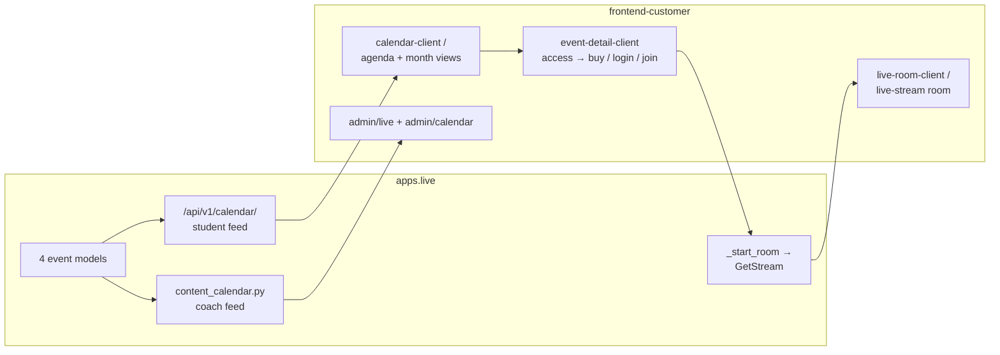

# Live Events & Calendar

# Live Events & Calendar

Everything a coach sells that happens at a _time_: live classes (in-app video), live streams (broadcast), Zoom classes, and in-person onsite events. The module spans a tenant-scoped Django app and the student/coach surfaces that consume it.

| Sub-module                                                            | Owns                                                                            |
| --------------------------------------------------------------------- | ------------------------------------------------------------------------------- |
| [Live Events & Calendar — apps](live-events-calendar-backend-apps.md) | `apps.live` models, serializers, views, GetStream rooms, the two calendar feeds |
| [Live Events & Calendar — src](live-events-calendar-frontend-src.md)  | Calendar/event pages, detail + purchase flow, GetStream room clients            |

## How the halves fit

The four backend models (`LiveClass`, `LiveStream`, `ZoomClass`, `OnsiteEvent`) are structurally near-identical and differ only in delivery and secret. That shape is what makes the frontend cheap: `src/types/live.ts` mirrors them 1:1, and the calendar pages never branch on kind — they read one unified `/api/v1/calendar/` feed that the backend flattens across all four tables.

Only `LiveClass` and `LiveStream` reach GetStream; Zoom and onsite events carry a coach-supplied link or address instead, so their detail pages terminate at "here is the secret" rather than at a room client.

## Workflows that cross the boundary

**Publish.** A coach creates an event in `admin/live`; the list/create views (`live_class_list_create` and siblings) run the shared `_serialize_list_response` and push pricing through `apps.billing.ways` — `set_ways` → `_clean` validates amount, kind and purchase window. Pricing rules therefore fail at _create_ time, in the billing app, not in `apps.live`.

**Discover.** `CalendarPage` builds its range with `getDateRangeParams`, fetches the unified feed, and `calendar-utils.ts` (`groupEventsByDate`, `isToday`, `formatEventWhen`) does all the date shaping for both the student month/agenda views and the coach's `UnifiedCalendar`. One utility file serves both calendars.

**Buy and join.** `get_access_info` on the serializer is the single source of truth for what a student may do; `EventDetailClient` renders exactly that verdict as buy / log in / join, with `EventStatusBadge` reflecting the model's computed live status (`computed_ended_at`). Pressing join calls `live_class_start` / `live_stream_start`, which mint a GetStream room via `_start_room`; `LiveRoomClient.init` then connects with the returned credentials.

**Hide.** `_hidden` on the detail views is the shared gate that keeps unpublished or access-restricted events out of every detail response, regardless of kind.
