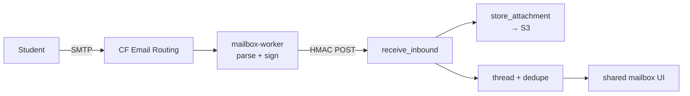

# Mailbox & Notifications

# Mailbox & Notifications

Two communication subsystems that reach students and coaches from opposite directions: **Mailbox** is real email (threaded conversations over an actual mail transport), **Notifications** is broadcast (announcements, Web Push, in-app feed). They share no models — the seams are `apps.core.email.send_email` and `sanitize_rich_text` from `apps.tenant_config.defaults`.

The organizing fact for mailbox is that **`apps.mailbox` is dual-listed** in `SHARED_APPS` and `TENANT_APPS`: public-schema rows are the superadmin ↔ coach platform inbox, tenant-schema rows are the coach ↔ student mailbox. Same models, same UI, two API bases, two auth mechanisms — which is why `views.py` pairs each public handler with a private one (`compose` → `_compose`, `reply` → `_reply`, `platform_conversation_list` → `_conversation_list`).

| Sub-module                                                           | Owns                                                                                                                                          |
| -------------------------------------------------------------------- | --------------------------------------------------------------------------------------------------------------------------------------------- |
| [Backend apps](mailbox-notifications-backend-apps.md)                | `apps.mailbox` (threading, identity, attachments, inbound webhook) and `apps.notifications` (announcements, audience, push, recurrence tasks) |
| [Cloudflare Email Worker](mailbox-notifications-infra-cloudflare.md) | Inbound MIME → signed JSON envelope → Django webhook                                                                                          |
| [Shared mailbox UI](mailbox-notifications-packages-shared.md)        | The Gmail-shaped client: folders, thread, `MessageEditor`, attachments                                                                        |
| [frontend-customer](mailbox-notifications-frontend-customer-src.md)  | Tenant API bindings, `AnnouncementCompose`, `AnnouncementBell`, PWA push handshake                                                            |
| [frontend-main](mailbox-notifications-frontend-main-src.md)          | Superadmin `/admin/inbox` shell + the platform HTTP client                                                                                    |

## Inbound mail

The Worker deliberately knows nothing: it parses, signs, POSTs, and decides whether to bounce. Tenant resolution, dedup, threading and `store_attachment` (which reaches `apps.core.storage` for the tenant-scoped S3 path) all live in `receive_inbound`. Outbound goes the other way — `sending_identity` picks the address (falling back to `platform_address` for the public inbox), `send_email` ships it via Resend.

Both frontends mount the _same_ components from `packages/shared/src/mailbox`; the only thing each app supplies is an API client at `@/lib/mailbox` — tenant JWT in frontend-customer, platform auth in frontend-main. That seam is why the superadmin inbox is barely more than a route shell.

## Announcements

A coach writes in `AnnouncementCompose` (autosave via `saveQuietly`, templates through `TemplatePickerModal`, all persisted through `src/lib/announcements.ts`). On send, `resolve_audience` turns the filters into recipients, `send_announcement_to_recipients` builds one `announcement_payload` per channel — Web Push to `subscriptions_with_access`, in-app to the `AnnouncementBell` feed, and `send_announcement_emails` as the optional fallback. Recurring rules (`AnnouncementRecurringList`) re-enter the same path from `_dispatch_recurrences_for_current_tenant`, so a scheduled announcement and a manual one are indistinguishable downstream.

Push subscription itself is a frontend-customer concern — the service worker handshake lives there, and `subscriptions_with_access` filters stale or access-revoked endpoints before any send.
