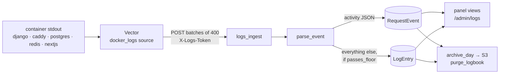

# Observability & Usage Analytics

# Observability & Usage Analytics

Two independent subsystems, deliberately kept apart:

|          | **Logbook** (`apps.logbook`)                            | **Usage** (`apps.usage`)                  |
| -------- | ------------------------------------------------------- | ----------------------------------------- |
| Audience | Superadmin (us)                                         | Coach (tenant owner)                      |
| Schema   | Public (SHARED_APPS)                                    | Per-tenant (TENANT_APPS)                  |
| Question | "What is the platform doing right now, and who did it?" | "Are my students installing the app?"     |
| Surface  | frontend-main `/admin/logs`, `/admin/health`            | frontend-customer `/admin` dashboard card |

There is no Prometheus/Grafana stack. The logbook **is** the observability stack: container stdout → Vector → Postgres → a faceted viewer, with a nightly gzip export to object storage for anything older than two weeks.

---

## Part 1 — Logbook

### The pipeline



Vector (`monitoring/vector/vector.yaml`) is **dumb transport**. It tails the Docker socket, reshapes each event to `{timestamp, container_name, stream, message}`, and POSTs. It knows nothing about levels, tenants or users — all of that is decided in Django so a parser change needs no container restart. Django/celery containers get a multiline rule (`start_pattern: ^\d{4}-\d{2}-\d{2}T`) so a traceback arrives as one event; the vector container excludes itself to avoid a feedback loop.

Disk buffer is 256 MiB with `when_full: drop_newest` — a Django outage parks logs on disk rather than back-pressuring the app.

### Writing the activity trail: `activity.py`

`RequestActivityMiddleware` is registered **last** in `MIDDLEWARE`, so its `process_response` runs _first_ on the way out — by then DRF has set `request.user` (DRF's `Request.user` setter propagates to the underlying `HttpRequest`). It performs **zero DB writes**: it emits one JSON line on the `apps.logbook.activity` logger and the line rides the pipeline back in as a `RequestEvent`.

```python
logger.info(json.dumps({"kind": "api", "tenant": …, "user": …, "ip": …,
                        "session_id": …, "method": …, "path": …,
                        "status": …, "duration_ms": …, "user_agent": …}))
```

The whole `_record` call is wrapped in `contextlib.suppress(Exception)` — activity capture must never break a response.

Two helpers are shared with the beacon view:

- `client_ip(request)` — `CF-Connecting-IP` → first hop of `X-Forwarded-For` → `REMOTE_ADDR`. Everything is behind Cloudflare and Caddy, so `REMOTE_ADDR` alone is the proxy.
- `redact_path(full_path)` — replaces the values of `LOGBOOK_REDACT_PARAMS` (`token`, `key`, `code`, `signature`, `session`, `password`) with `"redacted"` and caps at 512 chars. Magic-link tokens must never land in a 14-day table or an S3 archive.

`LOGBOOK_ACTIVITY_EXCLUDE_PREFIXES` skips health probes, static files, and — importantly — `/api/v1/platform/logs/`, `/api/v1/platform/activity/` and `/api/v1/track/`, which would otherwise self-amplify (reading the log viewer would generate log rows about reading the log viewer).

The `apps.logbook.activity` logger is pinned at `INFO` with `propagate: False` in `LOGGING`: the trail is data, not diagnostics, and must not vanish when an operator raises `DJANGO_LOG_LEVEL`.

### Attributing a line to a user: `context.py`

Middleware alone can never see the JWT user — DRF resolves the token at view level. So the flow is inverted:

1. `TenantJWTAuthentication.authenticate()` (in `apps/accounts/authentication.py`) calls `set_current_user(user.email)` on success.
2. `UserContextFilter` stamps `record.user` on **every** log record from that point on, feeding the `[user=%(user)s]` field of the console formatter.
3. `UserContextMiddleware` calls `reset_current_user()` in a `finally`.

The reset is not optional: gthread workers reuse threads, so without it a line logged between requests would carry the previous request's user. The filter swallows every exception — logging must never raise.

### Parsing: `parsing.py`

All per-container-family format knowledge lives here. `parse_event(raw)` dispatches on the normalized container name (`service_from_container` strips the `contentor-` prefix and any `-dev`/`-1` suffix):

- **`django`, `celery-worker`, `celery-agents`, `celery-beat`** → `_parse_app_line`: `_DJANGO_RE` matches the console formatter and pulls level/logger/tenant/user/message. When `logger_name == ACTIVITY_LOGGER`, the body is `json.loads`-ed into `ParsedEvent.activity` — that flag is what routes the event to `RequestEvent` instead of `LogEntry`. Falls through to `_GUNICORN_RE`, then to `_heuristic_level`.
- **`caddy`** → JSON line, read `level`.
- **`postgres`** → `_POSTGRES_RE` (`LOG|WARNING|ERROR|FATAL|PANIC|STATEMENT|DETAIL|HINT`).
- **`redis`** → `_REDIS_RE`; only the `#` mark is a warning.
- **anything else (next.js, minio, …)** → `_heuristic_level` keyword scan.

Guiding rule: **an unparseable line is kept as INFO with the raw line as the message.** A parser bug must never silently drop logs.

`passes_floor(container, level)` applies `LOGBOOK_LEVEL_FLOORS` — our own services store from `INFO`, everything else from `WARNING` (`"*"`). The floor applies only to `LogEntry`; activity rows bypass it entirely.

Two sharp edges handled here: NUL bytes are stripped from the message (Postgres text columns reject `0x00`, e.g. Django logging a `/%00` path — one poisoned line would `DataError` the whole `bulk_create` batch, which Vector then retries forever), and `parse_ts` truncates nanosecond precision before `datetime.fromisoformat`.

### Ingest: `views/ingest.py`

`POST /api/v1/platform/logs/ingest/` — `@authentication_classes([])` + `AllowAny`, guarded by `hmac.compare_digest` against `settings.LOGS_INGEST_TOKEN` in the `X-Logs-Token` header. Empty token ⇒ `503 ingest disabled`. Batches over `MAX_BATCH = 500` get `413` (Vector sends 400).

The three sanitizers exist for the same reason as the NUL strip — one bad field would 500 the batch and Vector would retry it forever:

- `_ip_or_none` — `ipaddress.ip_address(str(value))`; `str()` first so an int isn't read as a packed address.
- `_int_or_none(value, max_value)` — rejects `bool` (an int subtype: `true` must not persist as `1`) and clamps to the column's range.
- `_text(value, max_len)` — strips NULs that `json.loads` decoded from `\u0000` escapes, then truncates.

Both models are written with `bulk_create(..., ignore_conflicts=True, batch_size=500)` against a `(container|kind, ts, line_hash)` unique constraint, where `line_hash = line_digest(message)` (MD5, `usedforsecurity=False`). That is what makes a Vector retry idempotent.

Response: `{"accepted": n, "logs": n, "activity": n}`.

### Models: `models.py`

Public-schema store, three tables:

- **`LogEntry`** — raw container lines. Indexed on `(level, ts)`, `(container, ts)`, `(tenant, ts)`, `(user_label, ts)`, `(ts)`, plus a **GIN trigram index on `message`** backing the panel's `q` substring search.
- **`RequestEvent`** — the api/pageview trail. Indexed on `(kind, ts)`, `(tenant, ts)`, `(user_label, ts)`, `(session_id, ts)`, `(ip, ts)`, `(ts)`. `session_id` is what stitches an anonymous visitor's journey together.
- **`LogArchiveDay`** — the S3 ledger, unique per `(date, kind)`.

**No `Meta.ordering` anywhere, on purpose** — a default ordering would pollute the facet `GROUP BY`s. Every query orders explicitly.

### The viewer API: `views/panel.py`

Four `IsSuperUser` endpoints under `/api/v1/platform/`: `logs/`, `logs/facets/`, `activity/`, `activity/facets/`.

**Faceted-search semantics.** Each facet dimension is counted under every _other_ active filter (plus `q`/`since`/`until`) but never its own — `_facet(build_qs, params, param_name, field)` calls `build_qs(params, skip=param_name)`. Picking `level=ERROR` narrows the container options to containers that _have_ errors, while the level facet keeps showing the alternatives. Zero-count options are omitted; `tenants`/`users` are capped at `FACET_LIMIT = 20` (the users facet accepts a `users_q` substring for the combobox).

**Keyset pagination.** `_paginate` orders `-ts, -id` and emits `next_cursor = "<iso ts>|<id>"`; the next request filters `ts < cts OR (ts = cts AND id < cid)`. `PAGE_SIZE = 100`, fetched as `PAGE_SIZE + 1` to detect the tail.

**Everything malformed is a 400, never ignored** — an unfiltered result mid-incident is worse than an error. `since`/`until`/`cursor`, and on the activity side `status_class` and `ip`, raise DRF `ValidationError` from the shared helpers, so every endpoint reusing those helpers enforces the same contract. Note that `status_class`/`ip` are validated even when their own dimension is skipped for a facet build.

`_status_class_q` turns `2xx`/`3xx`/`4xx`/`5xx` into an OR of `status__gte/__lt` ranges; the status facet counts each class with its own `.count()` rather than going through `_facet`, since it isn't a stored column.

### Page-view beacon: `views/track.py` + `packages/shared/src/tracking/`

`POST /api/v1/track/pageview/` is public. Auth is _optional_: `TenantJWTAuthentication` resolves the cookie when present and returns `None` for invalid tokens, so a visitor degrades to anonymous instead of 401-ing.

`PageViewThrottle` is a `SimpleRateThrottle` whose `get_cache_key` idents on `client_ip(request)` — DRF's default ident would be Caddy's address for every anonymous visitor behind the proxy, i.e. one shared bucket for the internet. Rate comes from `LOGBOOK_PAGEVIEW_RATE` (`60/min`).

The view validates that `path` starts with `/`, then emits the same JSON shape as the middleware with `kind: "pageview"`, `status`/`duration_ms` null, and a redacted `referrer`. Returns `202`. The row itself is created later by the ingest path — which is why `/api/v1/track/` is in the activity exclude list.

Client side:

- `session.ts` — `getSessionId()` mints a `crypto.randomUUID()` into **sessionStorage** (`ct_sid`) and sends it as `X-Session-Id`. sessionStorage-scoped by design: no persistent identifier for anonymous visitors. Blocked storage (private mode) returns `""` and tracking continues without stitching. `shouldTrack(prev, path, now)` dedupes same-path fires inside 1 s.
- `track-page-view.tsx` — `<TrackPageView />`, mounted once in each app's root layout (`frontend-main/src/app/layout.tsx`, `frontend-customer/src/app/layout.tsx`). Fire-and-forget `fetch` with `keepalive`, errors swallowed. **`pathname` only, never `useSearchParams`** — that hook would force a Suspense boundary and a CSR bailout in the static marketing layout; server-side query strings are captured (redacted) by the activity middleware instead. `referrer` is the previous in-app path, falling back to `document.referrer`.

### Retention: `archive.py` + `tasks.py`

Two beat tasks (`config/celery.py`): `archive_logbook_days` at 03:40, `purge_logbook` at 04:20.

`archive_day(day, kind)` streams the day's rows (`qs.iterator(chunk_size=2000)`) into an in-memory gzip NDJSON buffer and PUTs it to `s3://$AWS_BUCKET_NAME/{LOGBOOK_ARCHIVE_PREFIXES[kind]}YYYY/MM/DD.ndjson.gz` via `apps.core.storage.get_s3_client` (MinIO in dev, Hetzner in prod). It is idempotent — an existing `LogArchiveDay` short-circuits — and an empty day still writes a ledger row with `object_key = ""`, which marks it done. `_LOG_FIELDS` / `_ACTIVITY_FIELDS` define the export schema.

`archive_logbook_days` walks `_day_range` (from the oldest row, clamped to `today - LOGBOOK_HARD_CAP_DAYS`, **excluding today**) and catches per-day exceptions so one bad day doesn't stop the rest; it retries tomorrow.

`purge_logbook` does two things:

1. **Hard cap** — anything older than `LOGBOOK_HARD_CAP_DAYS` (21) is deleted regardless of archive state, logged at `ERROR`. A persistently failing archive must not grow the table forever, and that ERROR surfaces in the panel itself.
2. **Normal retention** — days older than `LOGBOOK_RETENTION_DAYS` (14) that _have_ a `LogArchiveDay` row are deleted day by day. The ledger row is what licenses the delete; the archive is the long-term record (`zcat | grep` when needed).

### Settings (`config/settings/base.py`)

| Setting                             | Default                                        | Role                                               |
| ----------------------------------- | ---------------------------------------------- | -------------------------------------------------- |
| `LOGS_INGEST_TOKEN`                 | env, `""`                                      | Shared secret for the ingest endpoint; empty ⇒ 503 |
| `LOGBOOK_RETENTION_DAYS`            | 14                                             | Hot-store window for archived days                 |
| `LOGBOOK_HARD_CAP_DAYS`             | 21                                             | Unconditional delete, logs ERROR                   |
| `LOGBOOK_LEVEL_FLOORS`              | app services `INFO`, `*` `WARNING`             | Minimum stored level per container                 |
| `LOGBOOK_ACTIVITY_EXCLUDE_PREFIXES` | health/static/panel/track/dev                  | Paths that produce no `RequestEvent`               |
| `LOGBOOK_REDACT_PARAMS`             | token, key, code, signature, session, password | Query values replaced with `redacted`              |
| `LOGBOOK_ARCHIVE_PREFIXES`          | `logs/archive/`, `activity/archive/`           | S3 key prefixes                                    |
| `LOGBOOK_PAGEVIEW_RATE`             | `60/min`                                       | Per-real-IP beacon throttle                        |

### The superadmin viewer (frontend-main)

`src/lib/platform-logs-api.ts` is the typed client: `fetchLogs` / `fetchLogFacets` / `fetchActivity` / `fetchActivityFacets`, all through the shared same-origin cookie `clientFetch`. `LogsFilters` is deliberately `Record<string, string>` — param name → comma-joined values, matching the backend's `_multi` parsing. `sinceForRange(range)` converts the `TimeRange` chips (`15m`…`14d`) into the `since` ISO timestamp.

The page lives at `src/app/admin/logs/` (`page.tsx` + `logs-table.tsx`, `activity-table.tsx`, `filters.tsx`) with the `logs` / `activity` tabs mirroring the two endpoint pairs. `LogRow` and `ActivityRow` mirror `LOG_FIELDS` and `ACTIVITY_FIELDS` exactly.

`/admin/health` is a separate, much simpler page: it polls `/api/health/` through `useAsyncAction` and renders three status cards (Overall / Database / Redis).

---

## Part 2 — Usage analytics (`apps.usage`)

A tenant app answering one product question: _is the PWA actually being installed and used by students?_ (see the native-app-vs-PWA decision).

### Model

`UsageEvent(user, mode, platform, day)` with `unique_together` on all four — **one row per student per mode/platform per day**, not per session. `mode ∈ {pwa, browser}`, `platform ∈ {ios, android, desktop, other}`. No tenant column: the request runs in the tenant's schema on the customer subdomain, so the row lands in the right place by construction.

### `record_usage` — `POST /api/v1/me/usage/` (`IsAuthenticated`)

Validates `mode`/`platform` against the module-level sets (400 otherwise), then returns `204` immediately for anyone whose `role != "student"` — coaches and owners live in the admin app and are out of scope.

The `get_or_create` is wrapped in `contextlib.suppress(IntegrityError)`: two tabs POSTing concurrently race the unique constraint, and today's row already exists, so swallowing it beats a 500.

It also maintains three denormalized fields on `User`, saved with `update_fields` only when something actually changed: `last_display_mode`, `last_platform`, and `first_pwa_at` (set once, the first time a student arrives in standalone mode). `installed_students` in the summary is a count of students with a non-null `first_pwa_at`.

### `usage_summary` — `GET /api/v1/admin/usage/summary/?days=30` (`IsCoachOrOwner`)

`days` is clamped to `[1, 365]`, defaulting to 30 on anything unparseable. Returns conditional-aggregate totals (`pwa_sessions`, `browser_sessions`, `pwa_pct`), `installed_students`, and a `daily` series of `{day, pwa, browser}`.

### Client

- `frontend-customer/src/lib/usage.ts` — `detectPlatform()` (note the iPadOS branch: it asks for the desktop site so its UA says _Macintosh_; only `navigator.maxTouchPoints > 1` gives it away) and `reportUsageOncePerSession()`, which **sets the sessionStorage flag before the request** so a failure never re-fires. `isInAppBrowser()` is exported here for the install prompt — Instagram/TikTok/LinkedIn webviews cannot add to home screen.
- `components/shared/usage-reporter.tsx` — `<UsageReporter authed={hasSession} />` in the customer root layout. Reports only when authed (anonymous would just 403) and never under `/admin`.
- `components/admin/usage-adoption-card.tsx` — the coach's "App adoption (30 days)" card on `/admin`, rendered by the dashboard. `PageState` + skeleton for the initial load, a `reloadKey` retry, and a dependency-free CSS bar chart (`flex h-16 items-end gap-px`, each bar split by PWA share). Returns `null` when there is no data and no error, so a quiet tenant sees nothing rather than an empty card.

Demo data: `apps/demo_seed/seeding_helpers.py` fabricates `UsageEvent` rows with the same one-row-per-day semantics as the live endpoint.

---

## Contributing

**Adding a field to the activity trail.** Four places move together: the payload dict in `activity.py:_record` (and `views/track.py:post` if it applies to pageviews), `_request_event` in `views/ingest.py` with the right sanitizer, a migration on `RequestEvent`, then `ACTIVITY_FIELDS` in **both** `views/panel.py` (API output) and `archive.py` (`_ACTIVITY_FIELDS`, export schema) — plus `ActivityRow` in `platform-logs-api.ts`. Forgetting the archive list silently drops the field from the long-term record.

**Teaching the parser a new container.** Add the regex and a branch in `parse_event`, extend `_APP_SERVICES` if it uses our console formatter, and give it a floor in `LOGBOOK_LEVEL_FLOORS` (otherwise it inherits `"*"` = WARNING and you'll wonder where the INFO lines went). Vector's `include_containers` list needs the container name too.

**Adding a facet dimension.** Extend the `spec` dict in `_log_filters` / `_activity_queryset`, add a `_facet(...)` entry to the matching facets view, and add the param name to `PARAM_KEYS` in the viewer page. The `skip=` plumbing gives you the correct faceted-count semantics for free.

**Never trust an ingested value.** Every scalar that reaches a typed column goes through `_ip_or_none` / `_int_or_none` / `_text`. A `DataError` inside `bulk_create` fails the entire batch, and Vector's retry turns one malformed line into an infinite loop.

**Nothing in this module may break a request.** The middleware suppresses all exceptions, the logging filter swallows them, the beacon is fire-and-forget, and `reportUsageOncePerSession` catches everything. Keep it that way.

Tests live in `backend/apps/logbook/tests/` — `test_parsing.py` (per-container formats, level floors, nanosecond timestamps, message cap, empty lines), `test_context.py` (the contextvar default, the filter stamp, and the post-response reset), `test_activity.py` (`client_ip` priority, `redact_path` caps), `test_models.py` (digest stability, dedupe under `ignore_conflicts`), `test_panel_logs.py` / `test_panel_activity.py` (keyset pagination, equal-`ts` tiebreak, facet counts, 400s), and `test_tasks.py` (archive covers elapsed days, purge respects the ledger and the hard cap). Run them with `make test-app APP=logbook`.
