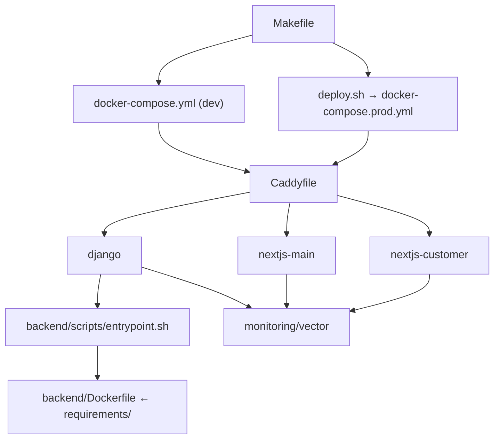

# Other

# Other

Everything in Contentor that isn't a Django app, a Next.js route, or a React component: the files that build the stack, run it, test it end to end, brief the agents that work on it, and document what all of it means. Nothing here imports anything else here — the coupling is by _convention and file path_, not by call graph. That is exactly why it breaks quietly.

Four layers, each with its own failure mode.

## 1. Agent instruction surface

Four root-level files that configure how an AI agent behaves in this repo. They have no importers, no tests, and no CI gate — their only consumer is whatever has them in context.

| File                                          | Role                                                                                                          |
| --------------------------------------------- | ------------------------------------------------------------------------------------------------------------- |
| [CLAUDE.md](claude-md.md)                     | Highest-precedence, always-loaded session instructions. Edit it and every future session reasons differently. |
| [agent.context.md](agent-context-md.md)       | The one-minute mental model: actors, tenancy, invariants.                                                     |
| [agent.commands.json](agent-commands-json.md) | Machine-readable projection of the `make` surface — the subset an agent actually needs.                       |

`agent.commands.json` is a derived view of the [Makefile](makefile.md). When a target is renamed or a workflow changes, both the JSON and `CLAUDE.md → Commands` go stale silently — nothing fails, the agent just runs the wrong thing. Same for `agent.context.md` when tenancy or auth rules move.

## 2. Build, run, deploy

The [Makefile](makefile.md) is the only entry point anyone is expected to learn; if a workflow isn't in `make help`, it doesn't exist. It shells into [docker-compose.yml](docker-compose-yml.md) for dev and hands prod to [docker-compose.prod.yml](docker-compose-prod-yml.md) — **not an override layer**, a separate self-contained stack. A setting that must hold in both (worker class, timeouts, log shipping) has to be edited twice.

One [Caddyfile](caddyfile.md) serves both, parametrized by env vars only. [backend/scripts/entrypoint.sh](backend-scripts.md) is the single place migrations, collectstatic and seeding run — `celery-worker` and `celery-beat` share the image and deliberately skip those steps. The image itself comes from [backend/](backend.md)'s `Dockerfile`, layered over [backend/requirements/](backend-requirements.md) (`dev.txt` and `prod.txt` are mutually exclusive; a runtime dep belongs in `base.txt` or prod breaks). [monitoring/vector](monitoring-vector.md) ships every container's stdout to Django's logbook — it is dumb transport, all parsing stays in `apps/logbook/`.

Frontend build config lives separately per app: [frontend-customer](frontend-customer.md) and [frontend-main](frontend-main.md). Both build with the **repo root** as Docker context so they can resolve [packages/shared](packages-shared.md), which has no `package.json` and no build step — its deps must be installed in _both_ consuming apps or a missing import surfaces as a type error.

## 3. Test harness

Three suites, three isolation levels:

- **pytest** — fixtures in [backend/](backend.md) (`conftest.py`) and [backend/apps/](backend-apps.md); runs inside the `django` container.
- **vitest** — config in each frontend's module page; runs inside the Next.js containers.
- **Playwright** — [e2e/](e2e.md) is the only suite that does _not_ containerize. It drives the real running dev stack over `http://localhost` through the same Caddy edge. Everything about its design follows from that: serial execution, self-healing fixtures, shared tenant state.

[e2e/helpers](e2e-helpers.md) carries the five recurring needs (authenticated browser, `manage.py` access via `compose.ts`, email readback, bucket pinning, Stripe Checkout) — no page objects, no global fixture file. [e2e/specs](e2e-specs.md) holds the specs themselves; `e2e/impact-map.json` maps a diff to the subset worth running, fail-closed with `00-smoke` always on, and `make lint` fails if a spec has no map entry. [e2e/playwright-report](e2e-playwright-report.md) is gitignored generated output from one past run — not current behaviour, don't read it as documentation.

## 4. Documentation and local tooling

[docs/](docs.md) is the written memory, but parts of it are _generated_ — `docs/wiki/` is mirrored from GitNexus and must never be hand-edited, `PRODUCT.md` is owned by the `/po` skill. [docs/superpowers](docs-superpowers.md) is the feature-work archive: a plan is an executable build queue, its paired spec is the decision record for why the design is what it is (including what was rejected).

Translation catalogs are pure data with no import edges — [frontend-customer/messages](frontend-customer-messages.md) and [frontend-main/messages](frontend-main-messages.md) couple by key path, enforced at runtime, not by the compiler. The same hazard applies to the global stylesheets in [frontend-customer/src](frontend-customer-src.md) and [frontend-main/src](frontend-main-src.md): class names and `data-*` attributes defined there are consumed by name from ~100 TSX call sites, so renaming a selector is a cross-file rename with no compiler to catch it.

Static assets and build-support scripts: [frontend-customer/public](frontend-customer-public.md) (generated service worker + the 220 MB committed logo catalog — two unrelated things in one directory) and [frontend-customer/scripts](frontend-customer-scripts.md) (a `postinstall` patch for a broken third-party `exports` field).

Standalone operational tooling runs _outside_ the app: [scripts/](scripts.md) (Postgres backup/restore, Stripe webhook forwarding), [infra/cloudflare](infra-cloudflare.md) (the inbound-email Worker — the one piece deployed with `wrangler`, not `make deploy`), [tools/flowmap](tools-flowmap.md) (crawls both frontends and renders real user journeys as screenshot DAGs), and [tools/wizard-mockups](tools-wizard-mockups.md) (regenerates the committed wizard screenshots).

## What spans these

**A new `make` target** touches the [Makefile](makefile.md), [agent.commands.json](agent-commands-json.md) and `CLAUDE.md → Commands` — only the first is enforced.

**A new env var** touches [docker-compose.yml](docker-compose-yml.md), [docker-compose.prod.yml](docker-compose-prod-yml.md), `.env.prod.example`, and Cloudflare KV via `secrets.sh` — there is no `.env.prod` on disk.

**A new backend dependency** touches [backend/requirements/](backend-requirements.md) and requires an image rebuild; hot-reload won't pick it up.

**A new e2e spec** must get an `impact-map.json` entry or `make lint` fails.

**A routing change** touches the [Caddyfile](caddyfile.md) for both environments at once — there is only one file, and `/api/*`, `/static/*` and apex `/django-admin/*` bypass Next.js entirely.
