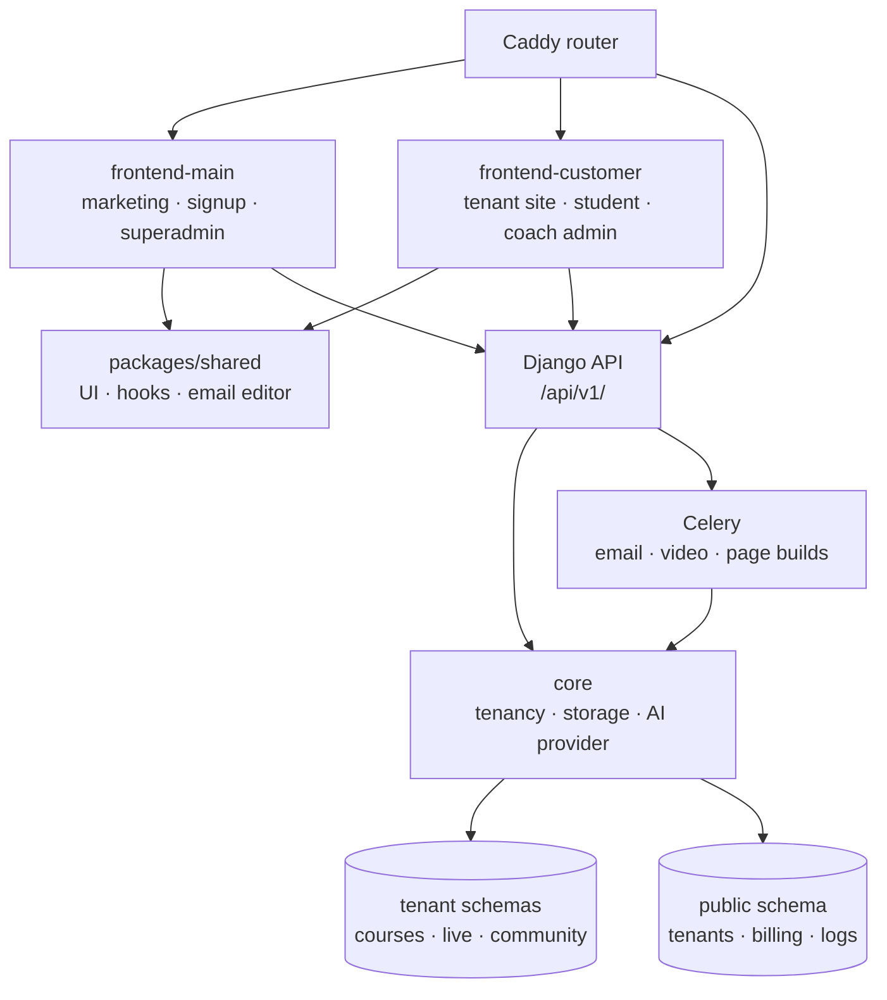

# contentor — Wiki

# Contentor

Contentor is a multi-tenant SaaS platform for content creators. A **coach** signs up, gets their own subdomain (`herbrand.contentor.app` or a custom domain), and sells courses, downloads, live sessions and email campaigns to their **students** — on a site the platform largely writes and designs for her. We (**superadmins**) run the platform itself from the apex domain.

The defining technical fact: **tenant isolation is one PostgreSQL schema per tenant** (`django-tenants`). Every request resolves a hostname to a schema before any feature code runs. Get that wrong and a coach sees another coach's students — which is why [Core Platform & Multi-Tenancy](core-platform-multi-tenancy.md) is the first page worth reading after this one.

## The shape of the system



Caddy sends the apex host to [frontend-main](marketing-site-app-frontend-main.md) and _every other host_ to [frontend-customer](student-portal-app-frontend-customer.md); `/api/*` goes straight to Django, never through Next. Both Next apps draw their primitives from the [Shared UI Library](shared-ui-library.md) — that's the heaviest edge in the whole graph, and it's deliberate: buttons, loading states, navigation feedback and the email editor exist once.

## How to think about the backend

`backend/apps/` splits in two, and the split is the mental model:

- **SHARED_APPS** live in the public schema — [accounts](authentication-accounts.md) (the `User` model, which uniquely exists in _every_ schema), [billing](billing-payments.md), [custom domains](custom-domains.md), the [superadmin console](superadmin-platform-console.md), the [logbook](observability-usage-analytics.md), and `core` itself.
- **TENANT_APPS** live per-tenant — [courses, downloads and media](courses-downloads-media-library.md), [live events](live-events-calendar.md), [community](community.md), [blog](blog-ai-content.md), [email campaigns](email-campaigns.md), [tenant config](tenant-config-site-builder.md), usage.

`apps.core.routers.TenantRouter` enforces the line. One app, `mailbox`, is deliberately dual-listed: public rows are the superadmin↔coach inbox, tenant rows are a coach's own — see [Mailbox & Notifications](mailbox-notifications.md).

Nearly every tenant app calls into `core` for the same handful of things: storage, email delivery, access gating, throttling. If you're changing something in `core`, assume you're changing something everywhere.

## Three flows worth tracing first

**A coach gets a site.** Signup on frontend-main → tenant provisioned → the `/setup` interview ([Onboarding Wizard & Site AI](onboarding-wizard-site-ai.md)) asks what she teaches, for whom, and in what style. An AI composer writes and lays out her pages as a block tree stored on a single `TenantConfig` row, [Tenant Config & Site Builder](tenant-config-site-builder.md). Go-live (`interview_golive.publish` → `setup_flow.act` → `start_page_build`) queues the page builds through Celery, then screenshots every page and has a model review them. Her brand mark is a versioned JSON recipe, never a bitmap — [Logo Studio & Brand Identity](logo-studio-brand-identity.md).

**A student buys something.** Student checks out in frontend-customer → Stripe direct charge on the coach's connected account with a platform application fee → one webhook endpoint, shared with the coach's own subscription to us, fans out to grant access. The two money flows share models and providers but nothing else; [Billing & Payments](billing-payments.md) is the page that keeps them straight.

**Someone talks to the AI.** One provider layer (`apps/core/ai.py`), one SSE framing convention, one conversation kernel with cost metering — and three chat surfaces on top: the coach's copilot, the student help bot, and the platform bot. See [AI Infrastructure & Assistants](ai-infrastructure-assistants.md). The copilot's write operations go through "doors" so every change lands in the coach's audit trail with an undo.

Two framework-shaped pieces cut across all of this: the [Admin Kit](admin-kit-framework.md) turns one Python declaration per model into both a CRUD REST surface and the metadata a generic React renderer uses — no hand-written admin UI in TypeScript; and the selective test runner and lint guards in [Developer Tooling](developer-tooling-flowmap.md) are what make `make test-changed` trustworthy.

## Getting it running

```bash
make health-check    # the stack is often already up — check before starting it
make dev-d           # start detached, returns when Django is healthy
make migrate seed
```

Dev bundles its own fakes: MinIO for object storage, an email sink, a fake live-video backend unless you point `LIVECRAFT_URL` at the sibling LiveCraft product. Secrets come from the root `.env`.

Verify at the cheapest level that covers your change:

```bash
make test-changed              # default — tests affected by your diff (PLAN=1 to preview)
make test-app APP=billing      # one backend app
make e2e-spec SPEC=04-live-class
make lint typecheck
```

`make help` lists the rest. The Docker VM is small and shared with other agent sessions — run one heavy job at a time, and check `ps` for a running Playwright suite before starting e2e.

## Before you edit

Read the `docs/wiki/` page for the area first — these pages describe design intent, and they're generated, so never edit them by hand. `docs/REFERENCE.md` holds the cross-cutting domain model and `docs/GLOSSARY.md` fixes the vocabulary (it's _creator_, _platform_, _live session_). For exact current callers and blast radius, the GitNexus graph tools beat grep.

Three rules that bite newcomers hardest, all from the tenancy layer: server-side `fetch()` from Next to Django **must** send `X-Tenant-Domain` (undici silently drops a custom `Host`, so you'd land in the public schema); public DRF endpoints need `@authentication_classes([])`, because `AllowAny` alone still runs the default JWT auth; and after touching any serializer, regenerate the frontend types with `npm run gen:api` and read the diff — a surprise there means the contract moved.
