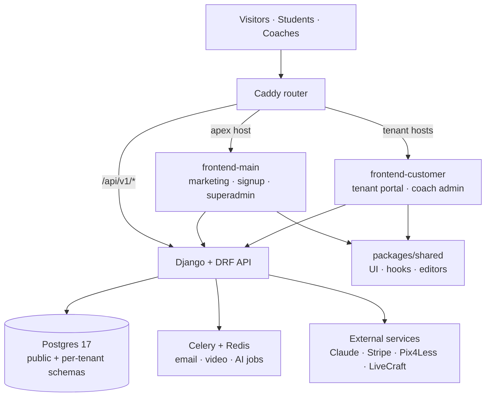

# contentor — Wiki

# Contentor

Contentor is a multi-tenant SaaS for content creators. A **coach** signs up on `contentor.app`, answers a guided setup interview, and gets their own branded site at `<slug>.contentor.app` (or a custom domain) where they sell courses, downloadable files, live sessions and memberships to their **students**. We — the platform operators — are the **superadmin**.

Two things make this codebase different from a typical Django + Next.js product:

1. **Tenant isolation is physical.** Every tenant gets its own PostgreSQL schema via `django-tenants`. A request's hostname decides which schema it talks to, before any feature code runs.
2. **The coach's site is authored by AI.** The setup interview composes real pages, writes real copy, picks photography and a logo, then screenshots the result and reviews it. There is no blank-canvas page builder to learn.

## The 10-second picture



Caddy is the only thing that knows about hosts. `contentor.app` and `tr.contentor.app` reach [frontend-main](marketing-site-app-frontend-main.md); every other host — tenant subdomains and custom domains — reaches [frontend-customer](student-portal-app-frontend-customer.md). `/api/*`, `/static/*` and the apex `/django-admin/*` go straight to Django and are never proxied through Next.

## Where to start reading

Read [Core Platform & Multi-Tenancy](core-platform-multi-tenancy.md) first. It owns the Django project root and the middleware chain every request passes through: region/locale resolution, then schema selection by hostname (or the `X-Tenant-Domain` header that server-side Next `fetch()` must send), then the shared primitives — storage, email, access control, throttling — that almost every other app calls into. Nearly every backend module has an edge pointing at it.

Then [Authentication & Accounts](authentication-accounts.md), because it holds the one model that breaks the usual shared/tenant dichotomy: `User` is a SHARED_APP table that nevertheless exists in _every_ schema. Public-schema users are coaches and superadmins; tenant-schema users are that tenant's students and staff. Auth is stateless JWT, and `TenantJWTAuthentication` is DRF's default — so any genuinely public endpoint (magic link, OAuth callback, signup) has to opt out explicitly.

After that, pick the area you're working in. The product features sit on top of those two foundations and mostly don't know about each other.

## What a coach gets

The customer-facing half of the product is the content they sell and the site they sell it from.

Courses, downloadable files and the media library live together in [Courses, Downloads & Media Library](courses-downloads-media-library.md) — models, access gating, the coach's management screens and the student's learning experience. Anything that happens at a _time_ — live classes, streams, Zoom sessions, in-person events, and the two calendar feeds — is [Live Events & Calendar](live-events-calendar.md); the in-app video itself is embedded from LiveCraft, a sibling product. Students talk to each other in [Community](community.md), a per-tenant social feed the coach moderates.

The site those things appear on is configured through a single resource — `GET/PATCH /api/v1/admin/config/` — documented in [Tenant Config & Site Builder](tenant-config-site-builder.md): brand, navigation, the block tree of every public page, chatbot knowledge, and the publish gate. The brand mark is designed in-product by [Logo Studio & Brand Identity](logo-studio-brand-identity.md), which rests on one invariant worth internalising early: a logo is a versioned JSON recipe, never an image — every preview, variant and export is a pure function of it.

Reaching students happens three ways: [Email Campaigns](email-campaigns.md) for designed broadcast email, [Mailbox & Notifications](mailbox-notifications.md) for threaded real email plus announcements and Web Push, and [Blog & AI Content](blog-ai-content.md) for SEO content. A coach who outgrows `<slug>.contentor.app` buys a real domain through [Custom Domains](custom-domains.md), which drives the whole lifecycle from availability search to DNS, email auth, SSL and yearly renewal.

## What we get

[Superadmin Platform Console](superadmin-platform-console.md) is our view across every tenant: workspaces, plans, subscriptions, AI spend, help-bot conversations. It is served from the apex host because it reads and writes the public schema only — no tenant context exists on those screens.

Most of those screens aren't hand-written. [Admin Kit Framework](admin-kit-framework.md) takes one Python declaration per model and produces both a CRUD REST surface and the metadata a generic React renderer uses to build tables, filters, forms and bulk actions. If you're adding an admin screen, declare the model — don't write TypeScript.

Observability is deliberately in-product: [Observability & Usage Analytics](observability-usage-analytics.md) covers the superadmin logbook (every container ships logs there via `vector` — that _is_ the observability stack, there is no Prometheus) and the separate per-tenant usage analytics a coach sees.

## Money

[Billing & Payments](billing-payments.md) carries two independent flows over shared models, providers and a single webhook endpoint: the **platform subscription** (coach pays Contentor, Stripe Checkout on our account) and the **marketplace** (student pays coach, direct charges on the coach's connected account with an application fee). They look similar and behave very differently — read that page before touching anything with "subscription" in the name.

## The AI layer

Everything Contentor does with Claude goes through one provider layer, one SSE framing convention, and one conversation kernel with cost governance, described in [AI Infrastructure & Assistants](ai-infrastructure-assistants.md). The chat surfaces on both frontends — the coach's copilot, the student help bot, the platform help bot — are thin clients over it.

The largest consumer of that layer is [Onboarding Wizard & Site AI](onboarding-wizard-site-ai.md): the path from "a creator typed a brand name" to "a provisioned tenant serving a composed, written, illustrated site". It spans both frontends, a dedicated Django package, a shared pure resolver, and the AI editing surfaces that keep the site changeable afterwards.

## Three flows worth tracing

**A coach gets a site.** Signup on frontend-main collects name and email → the setup interview in [Onboarding](onboarding-wizard-site-ai.md) asks what she teaches, who for, what she sells, and whether to use her own photos → a tenant schema is provisioned, the coach row is written to _both_ the public schema (`role=coach`) and the new tenant schema (`role=owner`, `is_staff`) → the composer builds the page block tree into [TenantConfig](tenant-config-site-builder.md), drawing photography from Pix4Less and a mark from [Logo Studio](logo-studio-brand-identity.md) → card verification and Checkout through [Billing](billing-payments.md) gate the build → the final visual check screenshots every page in both colour schemes and has Claude review them, routing safe fixes back through the copilot's audited doors.

**A student buys something.** A visitor lands on a tenant host, Caddy sends them to frontend-customer, the hostname resolves the schema, and the public pages render from `TenantConfig`'s block tree. A magic link auto-registers them as a student in that tenant schema. Checkout is an embedded Stripe panel charging the coach's connected account; on success the purchase unlocks access gating in [Courses](courses-downloads-media-library.md) or a seat in [Live Events](live-events-calendar.md), and a transactional email goes out through the native email renderer in [Email Campaigns](email-campaigns.md).

**A coach sends a campaign.** The shared block editor in `packages/shared/src/email/editor` drafts the email — the copilot can write or edit it in place — brand tokens and the coach's own offers resolve at send time, the campaign renders once and personalises per recipient, and Celery fans it out. Pictures survive in inboxes because tenant storage is private and images go out behind lasting `/api/v1/email/i/<token>/` links.

## Shared frontend code

Both Next apps consume [Shared UI Library](shared-ui-library.md) — primitives, the navigation-feedback layer, and the async-action hooks. This is the single highest-traffic dependency on the frontend side, and it comes with enforced conventions: `<Button loading>` over hand-rolled spinners, `useAsyncAction` around every async handler, `<PageState>` for first loads, `<StaleContainer>` for refinements, `<NavLink>`/`useNavigate()` for internal navigation so the progress bar works. `make lint` fails on violations, so following them up front saves a round trip. The same applies to text: nothing a person reads is hard-coded, and English is the source for `tr`, `de` and `pl`.

## Running it locally

The dev stack is one `docker compose` project behind Caddy — Postgres, Redis, Django under Gunicorn, both Next apps, four Celery queues, a headless Chromium sidecar, an ffmpeg sidecar, MinIO as the object store, and `vector` for logs.

```bash
make dev-d          # start detached, returns when Django is healthy
make health-check   # is it already up? (it usually is)
make migrate seed   # schema + demo tenant
make test-changed   # only the tests your diff affects
make help           # everything else
```

`make dev-d` is the one to use; foreground `make dev` blocks until it's killed, and killing it stops the stack. Containers hot-reload, so a code-only change never needs a rebuild. The Docker VM is memory-constrained and shared with other sessions — run one heavy job (full suite, e2e, production build) at a time.

Verify at the cheapest level that covers the change: `make test-changed` encodes which shared code forces a full run, so trust its plan (`PLAN=1` previews it). End-to-end specs in `e2e/` are the slowest gate; `make e2e-changed` maps the diff through `e2e/impact-map.json`, and `make e2e-spec SPEC=…` runs one while you iterate.

Local fakes stand in for the paid services: `CURATED_IMAGE_API_FAKE` swaps Pix4Less for offline fixtures, an inert fake replaces LiveCraft without `LIVECRAFT_URL`, `EMAIL_SINK_ENABLED` captures outbound mail for readback, and `BILLING_BYPASS_ENABLED` skips Stripe entirely. All of them refuse to run in production.

## Beyond the application code

[Developer Tooling](developer-tooling-flowmap.md) documents the selective test runner, the prod→dev demo-asset mirror, and the custom lint guards. [Other](other.md) collects the rest — compose files, the parametrized Caddyfile that serves both dev and prod, the Playwright suite, the agent instruction files, and the docs themselves. These have no importers and no call-graph coupling, which is exactly why they break quietly; the page explains each failure mode.

Production is two mini PCs on a home LAN behind Cloudflare, one active and holding all state, one running the app tier with a streaming Postgres standby. `make deploy` runs the full backend suite and then rolls both nodes.

---

Pages here describe design intent and were generated from the code graph. For exact current callers and blast radius, query the GitNexus MCP tools rather than trusting a page's call list; for product direction read `docs/PRODUCT.md`, and for cross-cutting facts `docs/REFERENCE.md` and `docs/GLOSSARY.md`.
