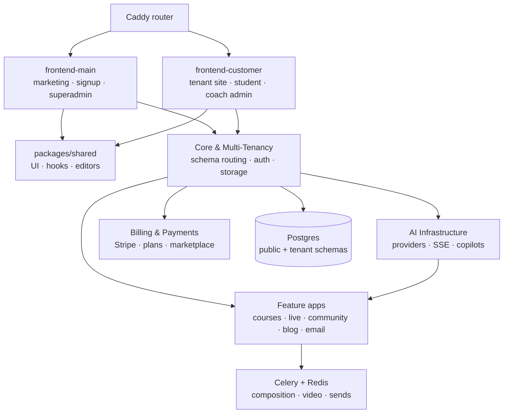

# contentor — Wiki

# Contentor

Contentor is a multi-tenant SaaS platform for content creators. A coach signs up, answers an AI-guided interview, and walks away with a provisioned tenant on their own subdomain — a styled site, a logo, course and download storefronts, live sessions, a student community, email campaigns, and Stripe payments — all authored by the system and editable afterwards.

Tenant isolation is **PostgreSQL schema-per-tenant** (`django-tenants`). Every tenant's students, content, and orders live in their own schema; coaches, plans, and platform billing live in the public schema. Caddy routes by hostname: the apex domain to the marketing app, every other host to the tenant portal.

## The 10-second picture



## The stack

- **`backend/`** — Django 5.1 + DRF, split into `config/` (settings, URLs) and `apps/`. Django apps are declared either as SHARED_APPS (public schema) or TENANT_APPS (per-tenant); [Core Platform & Multi-Tenancy](core-platform-multi-tenancy-apps.md) owns the middleware that picks the schema for each request, plus storage, email, throttling, and access control.
- **`frontend-customer/`** — Next.js 14, serves every tenant host: the public coach site, the student area, and the coach's admin studio. See [Student Portal App](student-portal-app-frontend-customer.md).
- **`frontend-main/`** — Next.js 14, serves the apex: marketing, signup, auth, and the [Superadmin Platform Console](superadmin-platform-console.md).
- **`packages/shared/`** — the [Shared UI Library](shared-ui-library.md), consumed by both apps. It is the single highest-traffic dependency in the repo: primitives, the navigation progress layer, `useAsyncAction`, and the email/logo editors.
- **`e2e/`** — Playwright specs mapped to code paths via `e2e/impact-map.json`.

Everything runs behind Caddy in dev and prod, with Postgres 17, Redis 7, Celery workers, and small sidecar services for headless Chromium and ffmpeg.

## Key end-to-end flows

**Signup → provisioned site.** A coach signs up on `frontend-main`, verifies a card, and enters the setup interview. [Onboarding Wizard & Site AI](onboarding-wizard-site-ai.md) runs the conversation, collects a brief, and hands it to the site composer: pages are queued, built block by block, restyled to the chosen look, and saved into `TenantConfig`. The final step screenshots every page and has a vision model review it before go-live. The flow is `setup_flow_golive → publish → _queue_page_builds → start_page_build → site_composer.save → restyle_pages` — if you are debugging a half-built site, that is the chain to walk.

**Request → tenant schema.** Every API call resolves region and locale, then a schema, before any feature code runs. Next.js server-side `fetch()` must send `X-Tenant-Domain` — Node's undici drops custom `Host` headers, which silently lands you in the public schema. Auth is a signed JWT with no server-side sessions; [Authentication & Accounts](authentication-accounts.md) owns issuance, magic links, OAuth, and impersonation, and its `User` table exists in _every_ schema.

**Student buys something.** [Billing & Payments](billing-payments.md) runs two money flows through shared models and one webhook endpoint: coach→platform subscriptions on the platform Stripe account, and student→coach marketplace charges as direct charges on the coach's connected account with an application fee. Purchases unlock access in [Courses, Downloads & Media Library](courses-downloads-media-library.md) or [Live Events & Calendar](live-events-calendar.md).

**Coach asks the AI for something.** [AI Infrastructure & Assistants](ai-infrastructure-assistants.md) is the one road to Claude: a provider layer, one SSE framing convention, and a conversation kernel with cost governance. On top of it sit the copilots that edit the site, draft blog posts, design emails, and critique logos. Feature modules call _into_ it rather than talking to a model directly — [Blog & AI Content](blog-ai-content.md), [Logo Studio & Brand Identity](logo-studio-brand-identity.md), [Email Campaigns](email-campaigns.md), and [Tenant Config & Site Builder](tenant-config-site-builder.md) all do.

**Coach configures the site.** One resource — `GET/PATCH /api/v1/admin/config/` → `TenantConfig` — backs brand, navbar, the block tree of every public page, chatbot knowledge, and the publish gate. [Tenant Config & Site Builder](tenant-config-site-builder.md) is where most "why does the site look like that?" questions end.

Around these sit the rest: [Community](community.md) (in-tenant social feed), [Mailbox & Notifications](mailbox-notifications.md) (real threaded email plus Web Push broadcasts), [Custom Domains](custom-domains.md) (buy a domain, get DNS + SSL + tenant routing), [Admin Kit Framework](admin-kit-framework.md) (one Python declaration per model → a full CRUD API _and_ the metadata a generic React renderer turns into tables and forms), and [Observability & Usage Analytics](observability-usage-analytics.md) — note there is no Prometheus/Grafana: the in-app logbook **is** the observability stack.

## Getting started

The dev stack is Docker Compose, hot-reloading, and usually already running.

```bash
make health-check     # is it already up?
make dev-d            # start detached, returns when Django is healthy
make migrate && make seed
make logs             # tail everything
```

Then: apex at `localhost`, a tenant at `<slug>.localhost`.

Day-to-day verification, cheapest level first:

```bash
make test-changed              # only what the diff affects (PLAN=1 to preview)
make test-app APP=billing      # one backend app
make test                      # full backend suite, ~1 min
make lint | format | typecheck
make e2e-spec SPEC=04-live-class   # one spec while iterating
make e2e-changed                   # specs the diff touches
```

One heavy job at a time — the Docker VM's RAM is fixed, and other agent sessions share the stack. Before any e2e run, check whether one is already going.

## Finding your way

Per-area deep docs live beside this page in `docs/wiki/`, named `<area>[-<location>].md` — **read the page for an area before working in it.** They are generated from the code graph and mirrored from `.gitnexus/wiki/`; never edit them by hand. For exact current callers and blast radius, trust the GitNexus MCP tools over the prose.

Cross-cutting references: `docs/REFERENCE.md` (domain model, auth/tenancy, billing, deploy), `docs/GLOSSARY.md` (canonical terms — say _creator_, _platform_, _live session_), and `docs/PRODUCT.md` (what's next). Repo-level tooling that never ships to users — the selective test runner, the demo-asset mirror, the custom lint guards — is covered in [Developer Tooling](developer-tooling-flowmap.md), and the build/deploy/agent-instruction files that belong to no module are in [Other](other.md).
