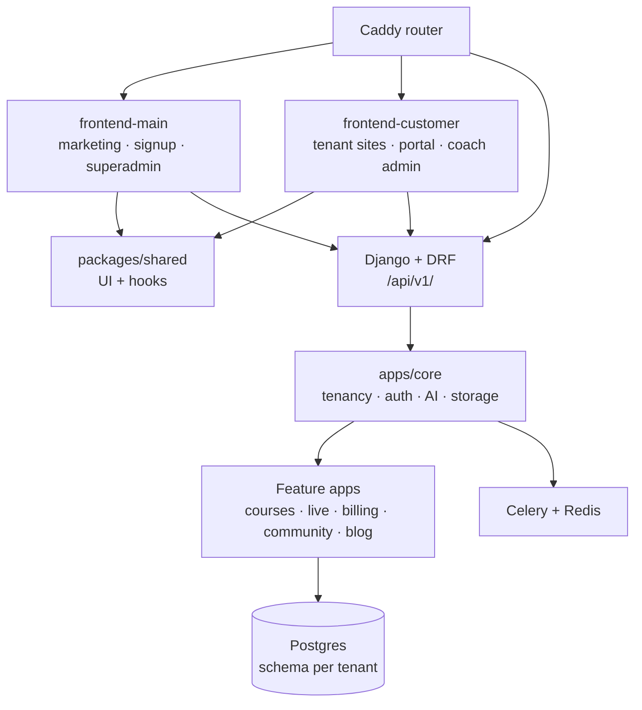

# contentor — Wiki

# Contentor

Contentor is a multi-tenant SaaS where content creators — we call them **coaches** — get their own branded site to sell courses, downloads, live sessions, and email campaigns to their **students**. A coach signs up on the marketing site, answers a short AI-guided interview, and walks away with a provisioned tenant at `theirbrand.contentor.app` (or their own domain) with pages, copy, a logo, and a colour palette already composed.

Isolation is **schema-per-tenant** on PostgreSQL via `django-tenants`. One Django deployment, one `frontend-customer` deployment, N tenants — nothing about a tenant is baked in at build time. Which schema a request lands in is resolved from the `Host` header (or the `X-Tenant-Domain` header for server-side `fetch()` from Next.js) on every single request.

## The shape of it



Caddy sends the apex host to [frontend-main](marketing-site-app-frontend-main.md) and _every other host_ to [frontend-customer](student-portal-app-frontend-customer.md); `/api/*` and `/static/*` go straight to Django, never through Next. Both frontends import their primitives, navigation feedback and async-action hooks from the [Shared UI Library](shared-ui-library.md) — it is by far the most-called module in the repo, and the loading/toast/navigation conventions it encodes are lint-enforced.

## Start at the foundation

Everything server-side passes through [Core Platform & Multi-Tenancy](core-platform-multi-tenancy-apps.md) before any feature code runs: region resolution, schema switching, storage, email, throttling, and the `SHARED_APPS` vs `TENANT_APPS` split that decides whether a model lives in the public schema or inside each tenant. Read that page first — almost every bug that _looks_ like a feature bug is really a schema or header question.

Identity sits right beside it in [Authentication & Accounts](authentication-accounts.md), which is unusual enough to call out: it's a shared app whose `User` table exists in _every_ schema — coaches and superadmins in public, students and staff per tenant. Auth is stateless JWT, and `TenantJWTAuthentication` is the DRF default, so any genuinely public endpoint must opt out explicitly.

## What a coach actually gets

The journey starts in [Onboarding Wizard & Site AI](onboarding-wizard-site-ai.md) — the interview that turns a few typed answers into a provisioned tenant with a composed site — and the result is owned by [Tenant Config & Site Builder](tenant-config-site-builder.md), which holds the look, navigation, page block tree, and the "ready to go live?" gate. Brand marks come from [Logo Studio & Brand Identity](logo-studio-brand-identity.md), where a logo is never an image but a versioned JSON recipe that renders to SVG on demand.

Then the coach fills the site: [Courses, Downloads & Media Library](courses-downloads-media-library.md) for the content and its access gating, [Live Events & Calendar](live-events-calendar.md) for classes, streams, Zoom sessions and onsite events, [Community](community.md) for the student feed, and [Blog & AI Content](blog-ai-content.md) for written posts. Reaching students happens through [Email Campaigns](email-campaigns.md) (rendered by the sibling MailCraft product, sent via Resend) and [Mailbox & Notifications](mailbox-notifications.md).

Money runs through [Billing & Payments](billing-payments.md), which carries two distinct flows on shared models: the coach's subscription to Contentor, and students paying coaches via Stripe Connect with an application fee. One webhook endpoint serves both. A coach who outgrows the subdomain buys a real one through [Custom Domains](custom-domains.md).

## Cross-cutting machinery

The [Admin Kit Framework](admin-kit-framework.md) is the one worth understanding early if you're adding models: a single Python declaration produces both the CRUD REST surface and the JSON metadata a generic React renderer turns into tables, filters and forms — no hand-written TypeScript admin screens. It backs both the coach's admin and the [Superadmin Platform Console](superadmin-platform-console.md).

Claude access is centralised in [AI Infrastructure & Assistants](ai-infrastructure-assistants.md) — one provider layer, one SSE convention, one conversation kernel with cost governance — and every AI surface in the product (site composer, blog drafting, copilot, help bot) sits on top of it rather than calling a model directly. Telemetry lives in [Observability & Usage Analytics](observability-usage-analytics.md): the superadmin logbook is the observability stack; there is no separate metrics system. Repo tooling — the selective test runner, lint guards, demo-asset mirror — is in [Developer Tooling](developer-tooling-flowmap.md), and build/deploy/agent-contract files are covered under [Other](other.md).

## A flow, end to end

A coach dragging video files onto `/admin/media` is a good trace of how the layers meet: `MediaPage` → `BatchDropzone` → `uploadMedia` in `src/lib/upload.ts`, which sniffs the kind, extracts duration or image dimensions client-side, derives a title from the filename, then uploads straight to object storage with a presigned URL from Django. The browser does the inspection work; the backend only records the result. Most feature flows in the repo have the same grain — a thin Next route or server component, a typed call through `src/lib/api-client.ts`, and a DRF view that has already been placed in the right schema by middleware it never sees.

## Running it locally

```bash
make dev-d          # stack up, detached, waits for Django health
make health-check   # it's probably already running — check first
make migrate seed
make test-changed   # default gate: only tests the diff affects
make lint
```

The stack is Caddy + Postgres 17 + Redis 7 + Django (Gunicorn) + both Next apps + Celery worker and beat, plus MinIO as the local object store. Containers hot-reload — never rebuild to verify a code-only change. The Docker VM has a fixed, modest RAM budget, so run one heavy job (full suite, e2e, production build) at a time.

A few local-dev substitutions are worth knowing before something looks broken: live video comes from the sibling LiveCraft product and runs as an inert fake unless `LIVECRAFT_URL` is set; photography is searched live from Pix4Less rather than stored here; outbound email is captured by a sink you can read back over HTTP; and Stripe runs in test mode.

## Conventions that bite

- Server-side `fetch()` from Next to Django **must** send `X-Tenant-Domain` — Node's undici silently drops a custom `Host`, which quietly lands you in the public schema.
- After changing a serializer, regenerate the frontend API types (`npm run gen:api` in `frontend-customer`) and read the diff: a surprise there means the contract moved.
- Internal navigation uses `<NavLink>` and `useNavigate()`, never raw `next/link` or `router.push` — they drive the top progress bar.

Per-area deep docs live alongside this page; read the relevant one before working in an area. `docs/REFERENCE.md` covers cross-cutting domain model, auth, billing and deploy detail, and `docs/GLOSSARY.md` is the canonical vocabulary.
