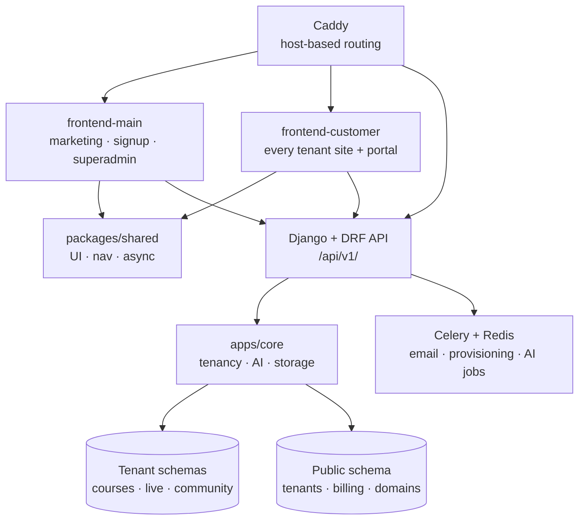

# contentor — Wiki

# Contentor

Contentor is a multi-tenant SaaS where content creators — we call them **coaches** — get their own branded website and sell courses, downloads, live sessions, and email campaigns to their **students**. A coach signs up on `contentor.app`, answers an AI-guided setup interview, and ends up with a provisioned tenant at `theirbrand.contentor.app` (or a custom domain they bought through us) serving an AI-composed, AI-written site with payments wired up.

Isolation is real isolation: every tenant gets its own PostgreSQL schema via `django-tenants`. There is no `tenant_id` column to forget in a `WHERE` clause — the schema is selected per request, before any view runs.

## Architecture in one picture



Caddy sits in front of everything in both dev and prod. The apex host goes to [frontend-main](marketing-site-app-frontend-main.md); **every other host** goes to [frontend-customer](student-portal-app-frontend-customer.md) — one deploy serving N tenants, with the tenant resolved per request from the `Host` header. `/api/*` and `/static/*` go straight to Django, never through Next.

## The backend

Django 5.1 + DRF, split into a public schema (coaches, plans, subscriptions, domains) and one schema per tenant (that coach's students, courses, events, posts). [Core Platform & Multi-Tenancy](core-platform-multi-tenancy-apps.md) owns the machinery that decides, for every request: which region, which schema, which user. Almost every other backend app calls into it — it is the single most depended-on module in the repo.

Identity lives in [Authentication & Accounts](authentication-accounts.md): JWT only, no server sessions, with magic links, emailed codes, and Google OAuth. The `User` table exists in _every_ schema, which is the detail that trips up newcomers most often — public rows are coaches and superadmins, tenant rows are that tenant's students and staff. `TenantJWTAuthentication` is the default DRF auth class, so any genuinely public endpoint must opt out explicitly.

The sellable content lives in [Courses, Downloads & Media Library](courses-downloads-media-library-backend-apps.md) and [Live Events & Calendar](live-events-calendar-apps.md) — four event types (in-app class, stream, Zoom link, onsite) sharing one shape and one calendar feed. [Community](community.md) adds the in-tenant social feed. [Blog & AI Content](blog-ai-content-backend-apps.md) runs both the coach blogs and the platform blog off one engine.

Money is [Billing & Payments](billing-payments-backend-apps.md), and it carries two independent flows through one webhook endpoint: the coach paying Contentor for a subscription, and students paying coaches via Stripe Connect direct charges with an application fee. [Custom Domains](custom-domains.md) handles the buy-a-domain lifecycle end to end — search, checkout, registration, DNS, SSL, renewal.

Outbound communication splits three ways: [Email Campaigns](email-campaigns.md) (rendered by the sibling MailCraft product), [Mailbox & Notifications](mailbox-notifications-backend-apps.md) (threaded coach↔student email plus Web Push broadcasts), and the transactional `send_email` helper in core that both sit on top of.

Two framework-shaped modules keep the admin surfaces cheap. [Admin Kit](admin-kit-framework.md) turns one Python declaration per model into both a CRUD REST surface and the JSON metadata a generic React renderer uses — nothing about a model's admin UI is hand-written in TypeScript. The [Superadmin Platform Console](superadmin-platform-console-apps.md) is built from it, served from the apex host because it never needs a tenant context.

## The AI layer

This is what makes Contentor unusual, and it is worth understanding early. [AI Infrastructure & Assistants](ai-infrastructure-assistants-backend-apps.md) is one provider layer, one SSE framing convention, and one conversation kernel with cost governance — with several chat surfaces on top.

The flagship consumer is [Onboarding Wizard & Site AI](onboarding-wizard-site-ai-backend-apps.md): the path from "a coach typed a brand name" to "a provisioned tenant serving a composed, written site." It spans both frontends, a dedicated Django package, and a shared pure resolver. [Logo Studio & Brand Identity](logo-studio-brand-identity-packages-shared.md) rests on one strict invariant — a logo is a versioned `LogoRecipe` JSON, never an image; every preview, variant, and export is a pure function of it, rasterized once in the browser.

[Tenant Config & Site Builder](tenant-config-site-builder-apps.md) stores the result: look, palette, navbar, the `pages` block tree, plus the setup checklist and the publish gate that answers "is this site ready to go live?"

## The frontends

Two Next.js 14 App Router apps sharing [packages/shared](shared-ui-library.md) — UI primitives, the navigation-feedback layer, and the `useAsyncAction` hook. Both apps consume it through re-export shims rather than importing it directly.

[frontend-main](marketing-site-app-frontend-main.md) is the public face: marketing, auth entry, coach signup and onboarding, the "my platforms" dashboard, and the superadmin console.

[frontend-customer](student-portal-app-frontend-customer.md) is the big one. It serves the public tenant site a visitor sees, the student portal behind login, _and_ the coach's own admin panel — all three for every tenant, with nothing baked in at build time.

The loading-and-feedback conventions in both apps are lint-enforced (`<Button loading>`, `<PageState>`, `<NavLink>`, sonner toasts). Read those rules before writing frontend code; a violation fails `make lint` rather than review.

## Two flows worth tracing

**A coach is born.** Signup on frontend-main → tenant provisioning creates the schema and a user in _both_ public (role=coach) and tenant (role=owner) → the AI setup interview collects brand, niche, tone, photos → the composer writes pages into `TenantConfig.pages` → milestones fire through `interview_milestones.fire` into `setup_flow`, which recomputes `publish_blockers` → when nothing blocks, the go-live step screenshots every page and has a vision model review it. That chain from `golive_state` down to `_seeded_by_label` is the single most interconnected path in the codebase.

**A student buys something.** Magic link auto-registers them in the tenant schema → they browse a course or live event on the tenant site → checkout creates a Stripe direct charge on the coach's connected account → the webhook grants access → gating in the courses/live apps lets the content through. Every step reads the schema the middleware already selected.

Supporting all of this: [Observability & Usage Analytics](observability-usage-analytics.md) (the in-app logbook superadmins read — there is no separate metrics stack), [Developer Tooling](developer-tooling-flowmap.md) (the selective test runner behind `make test-changed`), and [Other](other.md) for the build, deploy, and agent-orientation layer.

## Getting started

```bash
make dev-d          # stack up, detached, returns when Django is healthy
make health-check   # is it already running? check this first
make migrate seed   # schema + demo tenant
```

Then `localhost` is the marketing site and `demo-yoga.localhost` is a tenant. Dev compose bundles Postgres 17, Redis, MinIO (object store), a headless Chromium sidecar, and Vector for log shipping.

Day to day:

```bash
make test-changed              # default: only tests the diff affects (PLAN=1 to preview)
make test-app APP=billing      # one backend app
make lint | format | typecheck
make e2e-changed               # Playwright specs the diff affects
```

Prefer `make test-changed` — it already knows when a change touches shared runtime code and escalates to the full suite on its own. The Docker VM has a fixed, modest RAM budget: run one heavy job at a time, and never rebuild the stack to verify a code-only change, since containers hot-reload.

## Before you edit

Read the `docs/wiki/` page for the area you're touching — these pages describe design intent and save you re-deriving it. `docs/REFERENCE.md` covers cross-cutting concerns (domain model, auth, billing, deploy) and `docs/GLOSSARY.md` pins down the vocabulary. The repo is indexed by GitNexus, so for exact current callers and blast radius on a shared symbol, trust its MCP tools over the prose.

Three tenancy rules that cause most new-developer bugs:

1. Server-side `fetch()` from Next → Django **must** send `X-Tenant-Domain`. Node's undici silently drops a custom `Host`, so the request would quietly resolve to the public schema.
2. Build the tenant domain from the slug (`${slug}.${BASE_DOMAIN}`) in `generateMetadata` and `manifest.ts` — the runtime helper returns empty there.
3. A public endpoint needs `@authentication_classes([])`. `AllowAny` on its own is not enough.
