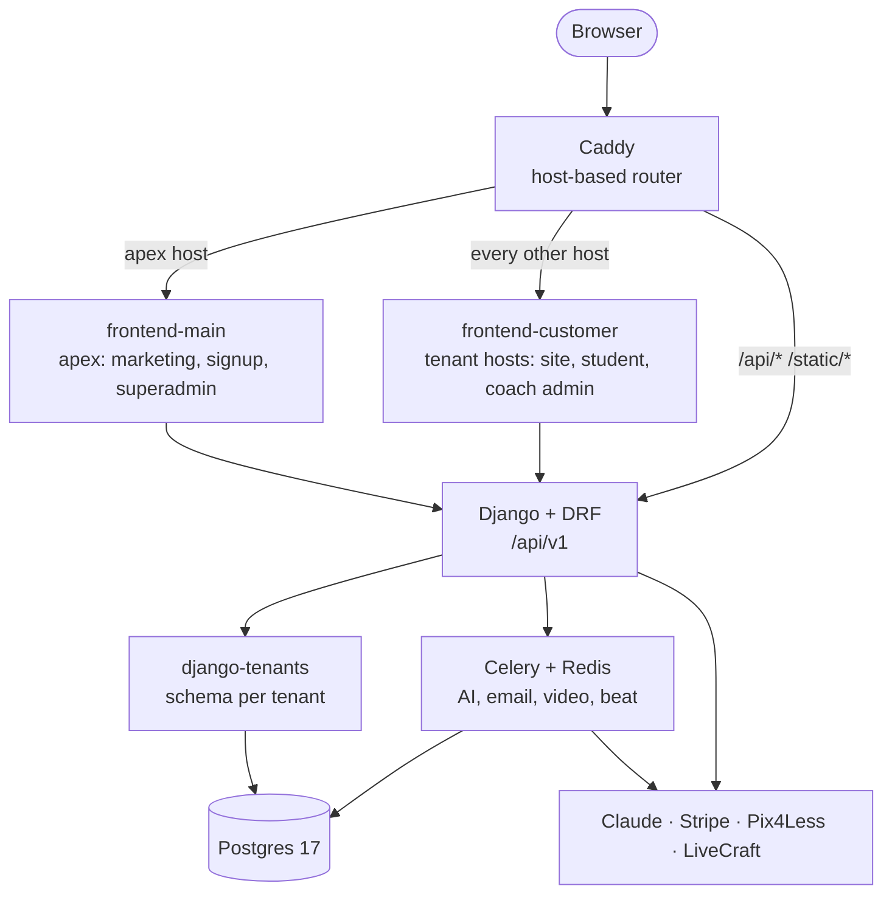

# contentor — Wiki

# Contentor

Contentor is a multi-tenant SaaS for content creators. A **coach** signs up, answers an AI-guided interview, and walks away with a working business: a branded site, courses and downloads, live sessions, a student community, email campaigns, and Stripe checkout — all at `<slug>.contentor.app` or their own domain. Their **students** buy and consume that content inside the tenant. **Superadmins** (us) run the platform from a separate console.

The defining constraint — the one that shapes almost every file in this repo — is **PostgreSQL schema-per-tenant isolation** via `django-tenants`. Each coach's data lives in its own schema; the public schema holds coaches, plans, subscriptions, and domains. Nearly every bug that surprises a new developer here is a schema-routing bug.

## Architecture at a glance



Caddy decides everything by hostname. The apex (`contentor.app`) goes to the [marketing site app](marketing-site-app-frontend-main.md); every other host — tenant subdomains and custom domains alike — goes to the [student portal app](student-portal-app-frontend-customer.md). `/api/*` and `/static/*` always go straight to Django, never through Next.js. The two Next apps share primitives through the [shared UI library](shared-ui-library.md), which owns the button/loading/navigation conventions both apps are linted against.

## The layers

**[Core Platform & Multi-Tenancy](core-platform-multi-tenancy.md)** is the floor. Every request passes through its middleware, which resolves region and locale, then picks the PostgreSQL schema from the hostname or the `X-Tenant-Domain` header, then applies access control and throttling. It also owns storage, email sending, and the AI provider plumbing. Read this page before any other — the rest of the codebase assumes you know how a request finds its schema.

**[Authentication & Accounts](authentication-accounts.md)** sits just above it. There are no server-side sessions: a signed JWT carries identity, and `TenantJWTAuthentication` is DRF's default auth class. The `User` table is unusual — it exists in _every_ schema, with coaches and superadmins in public and students in their tenant's schema. Core and Accounts call each other directly; most other modules call Accounts and nothing else below them.

**Content modules** sit on top and are almost entirely tenant-scoped: [courses, downloads and the media library](courses-downloads-media-library.md), [live events and the calendar](live-events-calendar.md) (in-app video is embedded from the sibling LiveCraft product), the student [community](community.md) feed, and [blog & AI content](blog-ai-content.md), which runs a coach blog and the platform blog on one engine.

**Commerce** is [Billing & Payments](billing-payments.md), which carries two independent money flows through one webhook endpoint: coaches paying Contentor for a plan, and students paying coaches through Stripe Connect with a platform fee. [Custom Domains](custom-domains.md) is the other place real money moves — it runs the full buy-a-domain lifecycle in the public schema.

**Brand and composition** is where Contentor differs most from a normal SaaS. [Tenant Config & Site Builder](tenant-config-site-builder.md) backs a coach's whole site from one resource — `GET/PATCH /api/v1/admin/config/` — holding brand, navigation, and the block tree of every public page. [Logo Studio & Brand Identity](logo-studio-brand-identity.md) treats a logo as versioned JSON, never a bitmap; everything downstream is a pure function of that recipe. [Onboarding Wizard & Site AI](onboarding-wizard-site-ai.md) is the system that fills all of it in automatically.

**AI** runs through a single spine described in [AI Infrastructure & Assistants](ai-infrastructure-assistants.md): one provider layer, one SSE framing convention, one conversation kernel with cost governance, and several chat surfaces on top. Site composition, blog drafting, email design, and the coach copilot all enter through it.

**Communication** splits two ways in [Mailbox & Notifications](mailbox-notifications.md) — real threaded email versus broadcast announcements and Web Push — and campaigns live in [Email Campaigns](email-campaigns.md), which since late 2026 renders block JSON into table HTML natively rather than calling an external service.

**Our own tooling** is the [Superadmin Platform Console](superadmin-platform-console.md) for running the business, [Observability & Usage Analytics](observability-usage-analytics.md) for seeing what the platform is doing (the in-app logbook _is_ the observability stack — there is no Prometheus here), and the [Admin Kit Framework](admin-kit-framework.md), a schema-driven admin layer where one Python declaration produces both a CRUD REST surface and the metadata a generic React renderer turns into tables, filters, and forms.

Repo-level scripts, the selective test runner, and the agent instruction surface are covered in [Developer Tooling & Flowmap](developer-tooling-flowmap.md) and [Other](other.md).

## Key end-to-end flows

**A coach becomes a live site.** Signup on the marketing site creates a user in the public schema and provisions a tenant schema, with a second user record inside it as owner. The coach lands in the setup interview, where an AI conversation collects what they teach, their audience, their photos, and their look. At go-live, `publish()` queues one page build per page; each `start_page_build` composes a block tree from the interview answers, pulls photography from Pix4Less (or the coach's own indexed photos), and writes it into `TenantConfig`. A final visual pass screenshots every built page and reviews it, routing safe corrections back through the copilot so they land in the coach's audit trail. This is the single most cross-cutting flow in the codebase — it touches onboarding, tenant config, AI, logos, and media in one chain.

**A student buys something.** A magic link auto-registers the student into the tenant schema. Browsing hits tenant-scoped content endpoints; checkout opens Stripe embedded Checkout against the coach's connected account, with Contentor taking an application fee. The webhook confirms the purchase, access gating flips, and the student sees the course, download, or live session in their portal.

**A coach runs their business.** The coach admin lives inside the tenant portal, not a separate app: content management, the calendar, community moderation, campaign design, and the AI copilot that can change the open page or email in place.

## Running it locally

The whole stack is Docker Compose — Caddy, Postgres, Redis, Django under Gunicorn, both Next apps, several Celery queues, and small sidecars for headless Chromium and ffmpeg.

```bash
make dev-d          # start detached, returns when Django is healthy
make migrate seed   # schema + demo tenant
make health-check   # is it already up?
```

Then: apex at `localhost`, a tenant at `<slug>.localhost`. The containers hot-reload, so a code-only change never needs a rebuild.

Day-to-day verification is deliberately cheap. `make test-changed` runs only what your diff affects (`PLAN=1` previews its plan), `make test-app APP=billing` runs one backend app, and `make lint` enforces the loading-state, i18n, and selector conventions that would otherwise fail later. End-to-end specs in `e2e/` are the slow gate — `make e2e-changed` maps the diff to the specs worth running. `make help` lists the rest.

## Before you start editing

Three conventions are worth knowing before the first pull request:

- Server-side `fetch()` from Next.js to Django **must** send `X-Tenant-Domain`. Node silently drops a custom `Host` header, so without it you quietly read the public schema.
- Public endpoints must set `@authentication_classes([])` — `AllowAny` alone is not enough, because JWT auth is the DRF default.
- No user-visible string is hard-coded. English is the source; `tr`, `de`, and `pl` are drafted from it.

Each module page goes deeper on its own area. Start with [Core Platform & Multi-Tenancy](core-platform-multi-tenancy.md), then read the page for whatever you are about to touch.
