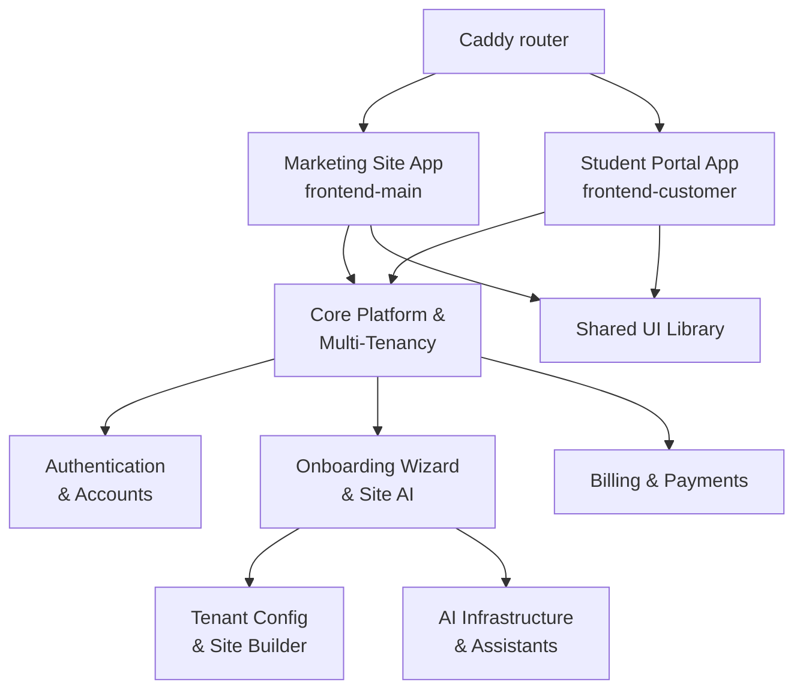

# contentor — Wiki

# Contentor

Contentor is multi-tenant SaaS for content creators. A **coach** signs up, gets a subdomain on `contentor.app`, and that becomes a full site: courses, downloads, live sessions, a blog, email campaigns, a community feed — sold to their **students**. We (the **superadmins**) run the platform underneath all of it.

The stack is Django 5.1 + DRF on Postgres 17, with two separate Next.js 14 apps in front, Redis + Celery for background work, and Caddy routing traffic at the edge. Tenant isolation is schema-per-tenant via `django-tenants`: every coach's data lives in its own Postgres schema, selected per-request from the hostname.

## The shape of a request



Caddy looks at the `Host` header and picks a frontend: the apex (`contentor.app`) goes to the [Marketing Site App](marketing-site-app-frontend-main.md), everything else — every tenant subdomain — goes to the [Student Portal App](student-portal-app-frontend-customer.md), which doubles as the coach's own admin panel. Both apps are one deploy serving every tenant; nothing about a tenant's identity is baked in at build time.

Every API request lands in [Core Platform & Multi-Tenancy](core-platform-multi-tenancy.md) first. It resolves region/locale, resolves the Postgres schema for the request, and hosts the cross-cutting primitives — storage, email, throttling — that the rest of the backend builds on. Identity itself belongs to [Authentication & Accounts](authentication-accounts.md): a shared `User` model present in every schema, JWT-based sessions (no server-side session store), magic links, email codes, and Google OAuth. Both frontends share one presentation layer, the [Shared UI Library](shared-ui-library.md), so buttons, loading states, and navigation feedback behave identically on both sides of the Caddy split.

## Signup to a live site

The most distinctive flow in the codebase: a coach types a brand name on the marketing site and ends up with a fully provisioned tenant running an AI-composed, AI-written site. That's [Onboarding Wizard & Site AI](onboarding-wizard-site-ai.md) — an interview that drives [AI Infrastructure & Assistants](ai-infrastructure-assistants.md) (the one Claude provider layer, SSE streaming, and cost-governed conversation kernel every AI feature in Contentor shares) to write copy, pick a look, and compose pages. The result is written into [Tenant Config & Site Builder](tenant-config-site-builder.md), which owns the tenant's theme, navigation, and page-block tree, plus the publish gate that decides when a site is ready to go live.

## What a tenant sells

Once live, a tenant's content lives across a handful of focused apps: [Courses, Downloads & Media Library](courses-downloads-media-library.md) for paid content and the media behind it, [Live Events & Calendar](live-events-calendar.md) for classes, streams, Zoom sessions and onsite events on one unified calendar, [Blog & AI Content](blog-ai-content.md) for AI-assisted posts (shared by both the coach's blog and the platform blog), and [Community](community.md) for the in-tenant social feed. Coaches reach their students through [Email Campaigns](email-campaigns.md) (rendered by the sibling MailCraft product) and [Mailbox & Notifications](mailbox-notifications.md) (threaded email plus web push). A coach can also point a real domain at their site via [Custom Domains](custom-domains.md), and build a brand mark from scratch in [Logo Studio & Brand Identity](logo-studio-brand-identity.md), where a logo is always a recipe, never an uploaded image.

## Money, administration, and running the platform

[Billing & Payments](billing-payments.md) is the one app serving two independent money flows — coaches paying Contentor for their subscription, and students paying coaches through a marketplace — sharing providers and a single Stripe webhook. Every model-backed admin screen in the product, on both the coach side and the superadmin side, is generated by the [Admin Kit Framework](admin-kit-framework.md) rather than hand-built; the superadmin-only views on top of it live in the [Superadmin Platform Console](superadmin-platform-console.md). [Observability & Usage Analytics](observability-usage-analytics.md) covers the two telemetry surfaces — the superadmin logbook and per-tenant usage stats — that watch all of this without being allowed to break it.

Finally, [Developer Tooling & Flowmap](developer-tooling-flowmap.md) holds the repo-level tooling (selective test/e2e runners, lint guards) that never ships to users, and the [Other](other.md) page is the catch-all for everything that shapes how Contentor is built, run, and deployed rather than what it does at runtime.

## Getting started

```bash
make dev-d          # bring the stack up, detached, waits for Django health
make health-check    # confirm it's already running before starting anything new
make test-changed    # the default test gate — only what your diff touches
make help            # everything else (migrate, seed, lint, e2e, deploy...)
```

Each module page above has the detail; `docs/REFERENCE.md` is the cross-cutting reference for domain model, auth/tenancy, and billing if you need the full picture in one place.
