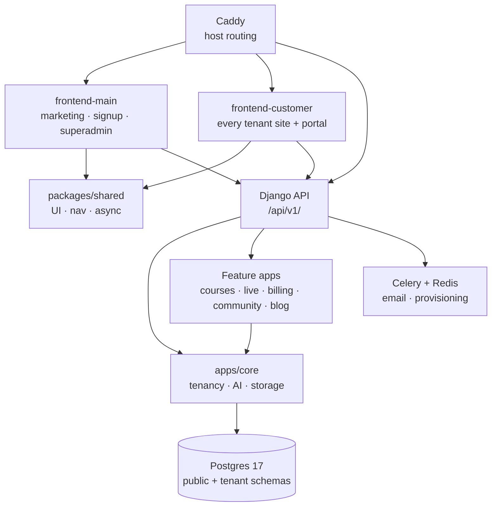

# contentor — Wiki

# Contentor

Contentor is a multi-tenant SaaS where content creators — we call them **coaches** — get their own branded website and sell courses, downloads, live sessions, and email campaigns to their **students**. A coach signs up on the marketing site, answers an AI-guided interview, and ends up with a provisioned tenant at `theirname.contentor.app` (or their own custom domain) running a site that was composed and written for them.

Tenant isolation is **PostgreSQL schema-per-tenant** via `django-tenants`. Every request resolves a hostname to a schema before any feature code runs. Three roles exist: coach (tenant owner, the paying customer), student (end user inside a tenant), and superadmin (the platform owner — us).

## The shape of the system



Caddy is the fork in the road: the apex (`contentor.app`) goes to [frontend-main](marketing-site-app-frontend-main.md), **every other host** goes to [frontend-customer](student-portal-app-frontend-customer.md), and `/api/*`, `/static/*` and the apex `/django-admin/*` go straight to Django — never proxied through Next.

One deploy of `frontend-customer` serves every coach's site. Nothing about a tenant is baked in at build time; identity comes from the `Host` header on each request.

## Backend

The Django side is `backend/config/` (settings split base/dev/prod) plus `backend/apps/`. Apps are split into **SHARED_APPS** (public schema: tenants, coaches, plans, domains) and **TENANT_APPS** (per-tenant schema: courses, live events, community, blog). [Core Platform & Multi-Tenancy](core-platform-multi-tenancy.md) owns that machinery — the middleware chain that picks a region, resolves a schema, and enforces access — along with storage, email, throttling, and the AI provider layer. Nearly every other app calls into it; it calls back into almost nothing.

[Authentication & Accounts](authentication-accounts.md) is the other near-universal dependency. It is a SHARED_APP whose `User` table nonetheless lives in *every* schema — coaches and superadmins in public, students and staff per tenant. Auth is stateless JWT, with `TenantJWTAuthentication` as the default DRF auth class. Public endpoints (magic link, OAuth, signup) must set `@authentication_classes([])`; `AllowAny` alone is not enough.

The product apps sit on top: [Courses, Downloads & Media Library](courses-downloads-media-library.md) for the content a coach sells, [Live Events & Calendar](live-events-calendar.md) for the four time-based event types (live class, stream, Zoom, onsite), [Community](community.md) for the in-tenant social feed, [Blog & AI Content](blog-ai-content.md), [Email Campaigns](email-campaigns.md), [Mailbox & Notifications](mailbox-notifications.md), and [Custom Domains](custom-domains.md).

Two framework-ish modules are worth knowing early because they save a lot of hand-written code. [Admin Kit](admin-kit-framework.md) turns one Python declaration per model into both a CRUD REST surface and the JSON metadata a generic React renderer uses to build tables, filters and forms — nothing about a model's admin UI is written in TypeScript. [Shared UI Library](shared-ui-library.md) (`packages/shared`) is the most-depended-on frontend package in the repo: the UI primitives, the navigation-progress layer (`NavLink` / `useNavigate`), and `useAsyncAction`.

Money lives in [Billing & Payments](billing-payments.md), which carries two independent Stripe flows through one webhook: coaches subscribing to Contentor, and students buying from coaches via direct charges on connected accounts.

## Frontends

Both apps are Next.js 14 App Router. They share `packages/shared` and little else — `frontend-main` is the apex (marketing, signup, the coach's "my platforms" dashboard, and the [Superadmin Platform Console](superadmin-platform-console.md)), `frontend-customer` is the tenant portal, public tenant site, and coach admin panel in one.

The one rule that catches everyone: **server-side `fetch()` from Next to Django must send `X-Tenant-Domain`**. Node's undici silently drops a custom `Host` header, so without it you end up reading the public schema. Build the domain from the slug (`${slug}.${BASE_DOMAIN}`) rather than relying on `getTenantDomain()` in `generateMetadata` or `manifest.ts`.

Client data access funnels through `src/lib/api-client.ts` (`clientFetch` → `extractDetail`). Nearly every interactive page in either app bottoms out there, so it is the right place to look when a request misbehaves.

## End-to-end flows worth tracing first

**Coach signup → live site.** Marketing signup collects a brand name, the [Onboarding Wizard & Site AI](onboarding-wizard-site-ai.md) runs an AI interview, then provisioning creates the tenant schema, writes a `User` row in *both* public (role=coach) and tenant (role=owner, is_staff) schemas, composes a styled site, and writes its copy. This is the only place in the product where a paying customer's whole site is authored by the system; it spans both frontends, a dedicated Django package, and a shared pure resolver.

**Student buys a course.** Magic-link login auto-registers the student in the tenant schema, [Billing](billing-payments.md) runs a direct charge on the coach's connected Stripe account with an application fee, and access gating in the content apps flips the course open.

**Coach brands the site.** [Logo Studio](logo-studio-brand-identity.md) holds one invariant worth internalizing: a logo is a versioned `LogoRecipe` JSON, never an image — the SVG preview, dark variant, brand-kit zip and exported PNGs are all pure functions of that recipe, rasterized once in the browser at export. [Tenant Config & Site Builder](tenant-config-site-builder.md) stores the resulting theme, navigation, and page block tree, and answers "is this site ready to publish?".

**Something went wrong.** [Observability & Usage Analytics](observability-usage-analytics.md) is the whole story: Vector ships every container's logs into the in-app logbook (superadmin → Logs). There is no separate metrics stack.

AI runs through one layer. [AI Infrastructure & Assistants](ai-infrastructure-assistants.md) owns the provider abstraction, one SSE framing convention, and a conversation kernel with cost governance; the chat surfaces in both frontends, the blog drafter, and the site composer all sit on top of it.

## Getting set up

```bash
make dev-d        # start the stack detached, returns when Django is healthy
make health-check # it's usually already running — check before starting
make migrate && make seed
```

The stack is Docker Compose: Caddy, Postgres 17, Redis 7, Django under Gunicorn, both Next.js dev servers, Celery worker + beat, and Vector. Containers hot-reload — never rebuild to verify a code-only change. The Docker VM has a fixed, modest RAM budget, so run **one heavy job at a time** (full test suite, e2e, or a production build — not two).

Verification, cheapest sufficient level first:

```bash
make test-changed              # default: only tests the diff affects (PLAN=1 to preview)
make test-app APP=billing      # one backend app
make test                      # full backend suite, ~1 min
make e2e-changed               # Playwright specs mapped from the diff
make lint | format | typecheck
```

Dev bundles local fakes so you don't need live third parties: MinIO for object storage, an email sink readable at `GET /api/v1/dev/emails/latest/?to=`, and a fake live-video backend unless you point `LIVECRAFT_URL` at a running [LiveCraft](../livecraft/). Photography comes from the Pix4Less service; `CURATED_IMAGE_API_FAKE=true` swaps in offline fixtures (dev and e2e only — prod refuses it). See [Developer Tooling](developer-tooling-flowmap.md) for the selective test runner and lint guards, and [Other](other.md) for build, deploy, and agent-orientation files.

## Conventions that are enforced

`make lint` fails on violations of the loading/feedback conventions, so following them up front saves a round trip: `<Button loading>` instead of raw spinners, `useAsyncAction` around async handlers, `<PageState>` + a `loading.tsx` per route segment, sonner toasts for action outcomes, `<StaleContainer>` for refinement loads, and `<NavLink>` / `useNavigate()` for all internal navigation.

After changing any serializer, run `npm run gen:api` in `frontend-customer` and read the `src/types/api-generated.ts` diff — a surprising diff means the API contract moved.

## Where to read next

Per-area deep docs live in `docs/wiki/`, generated from the code graph and refreshed by a git hook — read the page for an area before working in it. `docs/REFERENCE.md` covers cross-cutting concerns (domain model, auth and tenancy flows, billing, integrations, deploy), `docs/GLOSSARY.md` fixes the terminology, and `docs/PRODUCT.md` is the living product plan.
