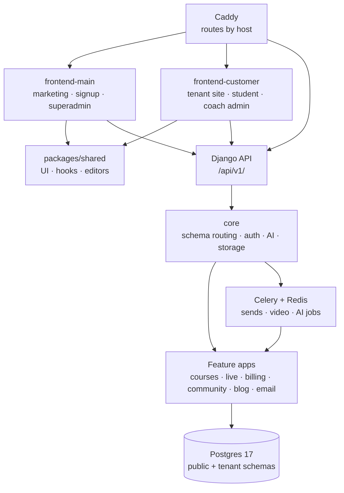

# contentor — Wiki

# Contentor

Contentor is a multi-tenant SaaS where content creators — we call them **coaches** — get their own branded site and sell courses, downloads, live sessions, and email campaigns to their **students**. A coach signs up on the marketing site, answers an AI-guided setup interview, and ends up with a provisioned tenant on `<slug>.contentor.app` (or their own custom domain) serving an AI-composed, AI-written site they can keep editing.

The stack: Django 5.1 + DRF + `django-tenants` + Postgres 17 + Redis + Celery on the backend, two Next.js 14 App Router frontends, all behind Caddy in dev and prod.

## The one thing to understand first

**Tenant isolation is schema-per-tenant, not a `tenant_id` column.** Every request resolves a hostname (or an `X-Tenant-Domain` header) to a PostgreSQL schema before any feature code runs. Django apps are split into `SHARED_APPS` (public schema — coaches, plans, subscriptions, domains) and `TENANT_APPS` (per-tenant schema — courses, students, community, live events). Get this wrong and you silently read the public schema; get it right and isolation is free.

The second thing: **Caddy routes by host.** The apex (`contentor.app`) goes to [frontend-main](marketing-site-app-frontend-main.md); _every other host_ goes to [frontend-customer](student-portal-app-frontend-customer.md). `/api/*` and `/static/*` go straight to Django, never through Next.



## Where the code lives

The backend is `backend/` — `config/` for the Django project and split settings, `apps/` for everything else. [Core Platform & Multi-Tenancy](core-platform-multi-tenancy.md) is the floor everything stands on: the middleware chain that resolves region → schema → tenant, plus the shared primitives (storage, email, access control, throttling, the AI provider layer) that the feature apps import. If you only read one module page before touching backend code, read that one.

Identity is [Authentication & Accounts](authentication-accounts.md). There are no server-side sessions — a signed HS256 JWT carries the user, and `TenantJWTAuthentication` is DRF's _default_ auth class, so any genuinely public endpoint (magic link, OAuth callback, signup) must set `@authentication_classes([])`; `AllowAny` on its own is not enough. This app is where you'll land most often, which is also why the rest of the backend calls into it more than anything else.

The features themselves divide by what a coach sells. [Courses, Downloads & Media Library](courses-downloads-media-library.md) covers the content a student consumes on demand; [Live Events & Calendar](live-events-calendar.md) covers anything that happens at a _time_ (live classes, streams, Zoom, in-person events); [Community](community.md) is the in-tenant social feed. Money runs through [Billing & Payments](billing-payments.md), which serves two independent Stripe flows on one webhook endpoint: coach→Contentor platform subscriptions in the public schema, and student→coach marketplace charges on the coach's connected account. Reaching people is split between [Email Campaigns](email-campaigns.md) (bulk, Celery fan-out, coach→student and superadmin→coach mirrored) and [Mailbox & Notifications](mailbox-notifications.md) (threaded real email, plus announcements and Web Push).

Everything about _how a tenant site looks and what it says_ starts at [Tenant Config & Site Builder](tenant-config-site-builder.md). One resource — `GET/PATCH /api/v1/admin/config/` → `TenantConfig` — backs the brand, the navbar, the block tree of every public page, and the chatbots' knowledge. The site's visual identity comes from [Logo Studio & Brand Identity](logo-studio-brand-identity.md), which rests on a single invariant worth internalizing: **a logo is a versioned `LogoRecipe` JSON, never an image.** Previews, dark variants, brand-kit zips and exported PNGs are all pure functions of that recipe, rasterized once in the browser at export time.

[AI Infrastructure & Assistants](ai-infrastructure-assistants.md) is one provider layer, one SSE framing convention, and one conversation kernel with cost governance, with three chat surfaces on top. [Onboarding Wizard & Site AI](onboarding-wizard-site-ai.md) is the biggest consumer of it, and [Blog & AI Content](blog-ai-content.md) runs both the per-tenant coach blog and the platform blog off the same engine.

Two framework-shaped modules are worth knowing before you hand-write admin UI: [Admin Kit Framework](admin-kit-framework.md) turns one Python declaration per model into both a CRUD REST surface _and_ the metadata a generic React renderer uses to build tables, filters and forms — nothing about a model's admin screens is written in TypeScript. The [Superadmin Platform Console](superadmin-platform-console.md) is built on it, served from the apex because it only ever touches the public schema. [Custom Domains](custom-domains.md) owns the buy→DNS→SSL→`django-tenants` domain lifecycle, and [Observability & Usage Analytics](observability-usage-analytics.md) is the whole observability story — the in-app logbook _is_ the stack; there is no Prometheus or Grafana.

On the frontend, [packages/shared](shared-ui-library.md) is the single source of truth for UI primitives, the navigation-feedback layer, and the async-action hooks — it's the most-depended-on module in the repo, and both apps consume it through re-export shims. The loading, toast and navigation conventions it encodes are enforced by a lint guard, so following them up front saves a round-trip. [Developer Tooling](developer-tooling-flowmap.md) covers the selective test runner behind `make test-changed`, and [Other](other.md) covers the compose files, e2e suite, and agent instruction surface that hold it all together.

## The flows that matter

**Coach signs up → has a live site.** Marketing site signup creates the user in _both_ the public schema (`role=coach`) and the new tenant schema (`role=owner`, `is_staff`). The AI setup interview in [Onboarding Wizard & Site AI](onboarding-wizard-site-ai.md) asks about the coach's work, her photos, her look and her price, then the composer writes a full block tree into `TenantConfig`. A screenshot pass reviews every finished page in both colour schemes before go-live, routing safe fixes back through the copilot so they land in the coach's audit trail with an undo.

**Student discovers → buys → consumes.** A visitor hits a tenant host, Caddy sends it to frontend-customer, which server-renders the block tree from `TenantConfig`. Checkout goes through [Billing & Payments](billing-payments.md) as a direct charge on the coach's connected Stripe account with a platform application fee. Access is then gated per resource by [Courses, Downloads & Media Library](courses-downloads-media-library.md) or [Live Events & Calendar](live-events-calendar.md), with students auto-registered into the tenant schema by magic link.

**Coach runs her business.** The `/admin` surface inside frontend-customer is where courses get authored, campaigns get designed in the shared email editor, the community gets moderated, and the AI copilot makes changes through audited "doors" rather than raw writes.

## Getting started

The dev stack is usually already running — check before starting anything:

```bash
make health-check          # is it up?
make dev-d                 # start detached, returns when Django is healthy
make migrate && make seed  # schemas + demo tenant
```

Use `make dev-d`, not foreground `make dev`, which blocks until timeout. Containers hot-reload, so never rebuild to verify a code-only change.

Day-to-day verification, cheapest sufficient level first:

```bash
make test-changed          # default: only tests the diff affects (PLAN=1 to preview)
make test-app APP=billing  # one backend app
make e2e-spec SPEC=04-live-class
make lint | typecheck
make help                  # everything else
```

Two constraints worth respecting from day one. The Docker VM has fixed RAM, so **one heavy job at a time** — never two test suites, a `next build`, and an e2e run together. And **other agent sessions share this stack**: before any e2e run, check whether a Playwright run is already going and wait for it rather than starting a second against the same demo tenant.

## Reading before writing

Per-area deep docs live in `docs/wiki/` (generated — never edit by hand); read the page for the area you're touching before working in it. `docs/REFERENCE.md` has the cross-cutting domain model, auth/tenancy flows, and deploy details; `docs/GLOSSARY.md` fixes the terminology (creator, platform, live session); `docs/PRODUCT.md` is the living product plan for any "what's next" question. The repo is also indexed by GitNexus — `query({search_query: "concept"})` finds execution flows faster than grep, and `impact({target: "symbolName"})` is worth running before changing anything in `packages/shared`, `apps/core`, the API client, or a billing provider.

Three house rules that bite newcomers: never hard-code text a person reads (four locales — en, tr, de, pl — are lint-enforced), never commit without pre-commit passing clean, and after changing a serializer run `npm run gen:api` in `frontend-customer` and read the generated-types diff — a surprising diff means the frontend contract just moved.
