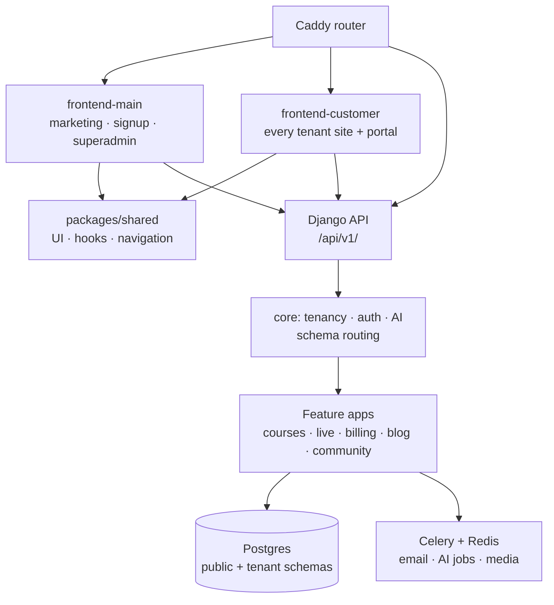

# contentor — Wiki

# Contentor

Contentor is a multi-tenant SaaS where content creators — we call them **coaches** — get their own branded website and sell courses, downloads, live sessions, and email campaigns to their **students**. A coach signs up on the marketing site, answers an AI-guided setup interview, and ends up with a provisioned tenant at `theirbrand.contentor.app` (or a custom domain) that already has a composed site, a logo, written copy, and demo content in it.

Isolation is **schema-per-tenant** PostgreSQL via `django-tenants`. One Django deployment, one `frontend-customer` deployment, N coaches — nothing about a tenant is baked in at build time. The tenant is resolved per request, from the hostname.

## The shape of the system



Caddy is the fork in the road: the apex host (`contentor.app`) goes to [frontend-main](marketing-site-app-frontend-main.md), **every other host** goes to [frontend-customer](student-portal-app-frontend-customer.md), and `/api/*`, `/static/*` and the Django admin go straight to Django — never proxied through Next.

## Three layers worth understanding first

**The foundation.** [Core Platform & Multi-Tenancy](core-platform-multi-tenancy-apps.md) is what every request passes through before any feature code runs: region resolution, schema selection (`HeaderAwareTenantMiddleware`, from the hostname or the `X-Tenant-Domain` header), storage, email, throttling. Django apps are split into `SHARED_APPS` (public schema: coaches, plans, domains) and `TENANT_APPS` (per-tenant: courses, community, live events). If you only read one module page before writing backend code, read this one — the tenancy rules here are the ones that bite.

[Authentication & Accounts](authentication-accounts.md) sits right on top: stateless HS256 JWTs, magic links, emailed codes, Google OAuth, impersonation. The `User` table lives in _every_ schema — public rows are coaches and superadmins, tenant rows are that tenant's students and staff. `TenantJWTAuthentication` is the default DRF auth class, so genuinely public endpoints must opt out explicitly.

**The features.** Each sells or serves something: [Courses, Downloads & Media Library](courses-downloads-media-library.md) for on-demand content, [Live Events & Calendar](live-events-calendar.md) for classes, streams and onsite events, [Community](community.md) for the in-tenant social feed, [Blog & AI Content](blog-ai-content.md) for coach and platform blogs, [Email Campaigns](email-campaigns.md) and [Mailbox & Notifications](mailbox-notifications.md) for reaching students. [Billing & Payments](billing-payments.md) runs two money flows through one Stripe webhook — coaches subscribing to Contentor, and students buying from coaches via Stripe Connect.

**The brand layer.** This is the unusual part of the product. [Onboarding Wizard & Site AI](onboarding-wizard-site-ai.md) runs the setup interview and composes an entire site from the answers; [Tenant Config & Site Builder](tenant-config-site-builder.md) stores the result (`TenantConfig`: look, palette, navbar, page block tree) and gates go-live; [Logo Studio & Brand Identity](logo-studio-brand-identity.md) holds the invariant that a logo is a versioned JSON _recipe_, never an image — the SVG, the dark variant and the exported PNGs are all pure functions of it.

Cross-cutting: [Admin Kit](admin-kit-framework.md) turns one Python declaration per model into both a CRUD REST surface and the JSON metadata a generic React renderer uses to draw tables, filters and forms — which is how both the [Superadmin Console](superadmin-platform-console.md) and the coach admin get built without hand-written TypeScript per model. [AI Infrastructure & Assistants](ai-infrastructure-assistants.md) is the single provider layer, SSE convention, and cost-governed conversation kernel behind every Claude call in the product. [Observability & Usage Analytics](observability-usage-analytics.md) is the logbook — telemetry here is best-effort by design and never breaks what it observes.

## How the frontends are built

Both Next.js 14 apps lean hard on [packages/shared](shared-ui-library.md) — it's the single busiest dependency edge in the repo. It owns the UI primitives, the navigation-feedback layer (`NavLink`, `useNavigate`, the top progress bar) and `useAsyncAction`. Those aren't suggestions: a lint guard in `make lint` fails the build on raw `next/link`, raw spinners, or unwrapped async handlers. Read the loading/feedback conventions in `CLAUDE.md` before writing a component.

`frontend-customer` carries three audiences in one app — public marketing pages, the logged-in student portal, and the coach's admin panel — all resolved from the `Host` header into a tenant context at request time.

## End-to-end flows to trace

- **Coach signs up → live site.** Marketing signup → tenant provisioned in both schemas (public `role=coach`, tenant `role=owner`) → setup interview → AI composes pages, picks a look and palette, drafts copy → final visual check screenshots every page and files what it finds → go-live.
- **Student buys a course.** Magic link auto-registers them in the tenant schema → Stripe direct charge on the coach's connected account with a platform fee → webhook grants access → gated content unlocks.
- **A coach uploads media.** `BatchDropzone` → `uploadMedia` detects kind, extracts dimensions or duration → presigned upload → Celery re-encodes. Worth reading as the canonical example of a frontend→storage path.

## Getting started

```bash
make health-check      # the stack is usually already up
make dev-d             # if not — detached, returns when Django is healthy
make migrate && make seed
make test-changed      # the default gate: only what your diff touches
make lint
```

A few things that will save you a confusing hour:

- Server-side `fetch()` from Next to Django **must** send `X-Tenant-Domain`. Node's undici silently drops a custom `Host`, so you'll land in the public schema and wonder where the data went.
- After changing a serializer, run `npm run gen:api` in `frontend-customer` and read the diff — a surprising one means the frontend contract moved.
- Don't rebuild the stack to verify a code change; containers hot-reload.
- The Docker VM budget is tight. One heavy job at a time.

Per-area deep docs live alongside this page in `docs/wiki/`, named `<area>[-<location>].md`. Read the page for an area before working in it. `docs/REFERENCE.md` covers cross-cutting concerns (domain model, auth flows, billing, deploy), `docs/GLOSSARY.md` fixes the terminology, and the [developer tooling](developer-tooling-flowmap.md) page explains the selective test runner and the custom lint guards. Everything that isn't application code — Docker, Caddy, CI, deploy, agent instructions — is documented under [Other](other.md).
