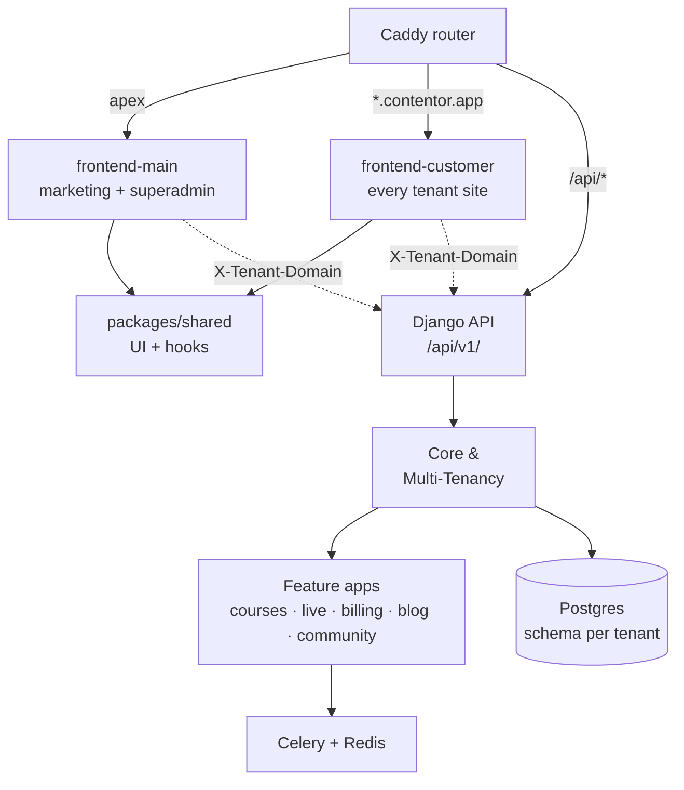

# contentor — Wiki

# Contentor

Contentor is a multi-tenant SaaS where content creators — we call them **coaches** — get their own branded website and sell courses, downloads, live sessions, and email campaigns to their **students**. A coach signs up on `contentor.app`, answers a short AI-guided interview, and walks away with a provisioned tenant at `theirbrand.contentor.app` (or their own domain) that is already designed, written, and ready to take payments.

Three roles run through everything you will read here:

- **Coach** — the paying customer; owns one tenant
- **Student** — an end user inside one coach's tenant
- **Superadmin** — us, operating the platform

## The one thing to understand first

Tenant isolation is **PostgreSQL schema-per-tenant**, via `django-tenants`. There is one Django process and one database; which schema a query lands in is decided per request from the hostname. Public schema = coaches, plans, subscriptions, domains. Tenant schema = that coach's students, courses, posts, config. Django apps are split into `SHARED_APPS` and `TENANT_APPS`, and a router keeps them apart.

Every request resolves region → schema → auth before a single line of feature code runs. That machinery, plus storage, email, and throttling, lives in [Core Platform & Multi-Tenancy](core-platform-multi-tenancy-apps.md) — the module nearly every other backend app calls into. Read it before you write backend code.

## Architecture



Four deployables, one repo:

**`backend/`** — Django 5.1 + DRF, split into `config/` and `apps/`. Settings are layered base/dev/prod.

**`frontend-customer/`** — one Next.js 14 app that serves _every_ tenant: the public marketing pages, the student portal, and the coach's admin panel. Nothing about a tenant is baked in at build time; identity comes from the `Host` header per request. See [Student Portal App](student-portal-app-frontend-customer.md).

**`frontend-main/`** — the apex host: marketing site, signup, the coach's "my platforms" dashboard, and the [Superadmin Platform Console](superadmin-platform-console-src.md). See [Marketing Site App](marketing-site-app-frontend-main.md).

**`packages/shared`** — the single busiest dependency in the repo. Both apps import their buttons, spinners, `useAsyncAction`, and the navigation-progress layer from [Shared UI Library](shared-ui-library.md). If you are writing UI, you start here, not in a feature folder.

Caddy sits in front in both dev and prod. `/api/*`, `/static/*`, and apex `/django-admin/*` go to Django directly — never proxied through Next.

### The tenancy trap

Next.js server-side `fetch()` → Django **must** send an `X-Tenant-Domain` header. Node's undici silently drops a custom `Host`, so without the header your query quietly runs against the public schema and you get an empty, confusing result rather than an error. This is the single most common way a plausible-looking change breaks.

## What the product is made of

Identity for everyone — coaches, students, superadmins — is [Authentication & Accounts](authentication-accounts.md): magic links, emailed codes, Google OAuth, impersonation, and stateless HS256 JWTs. There are no server-side sessions. Note that `TenantJWTAuthentication` is the _default_ DRF auth class, so genuinely public endpoints must declare `@authentication_classes([])` — `AllowAny` on its own is not enough.

What a coach sells lives in [Courses, Downloads & Media Library](courses-downloads-media-library-apps.md) and [Live Events & Calendar](live-events-calendar-apps.md) — the latter covering four event shapes (in-app class, stream, Zoom link, onsite address) that share one model shape and one calendar feed. Students talk to each other in [Community](community.md), read the coach's [Blog & AI Content](blog-ai-content-backend-apps.md), and receive [Email Campaigns](email-campaigns.md) and [Mailbox & Notifications](mailbox-notifications-backend-apps.md).

Money is [Billing & Payments](billing-payments-backend-apps.md), and it is two flows, not one: the coach's platform subscription to us, and student→coach marketplace purchases via Stripe Connect direct charges with an application fee. Same models, same webhook endpoint, different schemas.

The look of a tenant site is [Tenant Config & Site Builder](tenant-config-site-builder-apps.md) — brand, navigation, page block tree, and the publish gate — with the brand mark itself handled by [Logo Studio & Brand Identity](logo-studio-brand-identity-packages-shared.md), which stores logos as versioned JSON recipes and rasterizes only at export.

Two cross-cutting frameworks are worth knowing early. [Admin Kit](admin-kit-framework.md) turns one Python declaration per model into both a CRUD REST surface and the metadata a generic React renderer uses to draw the table, filters, and forms — so admin screens are not hand-written TypeScript. And [AI Infrastructure & Assistants](ai-infrastructure-assistants-backend-apps.md) is the single provider layer, SSE convention, and cost-governed conversation kernel that every AI feature in the product sits on.

Operational visibility is [Observability & Usage Analytics](observability-usage-analytics.md) — the in-app logbook _is_ the observability stack; there is no separate metrics system. Coaches who outgrow their subdomain go through [Custom Domains](custom-domains.md).

## End-to-end flows

**Coach signs up and gets a site.** Marketing form → account → Stripe card check → tenant provisioned (schema created, migrated, seeded) → the AI interview in [Onboarding Wizard & Site AI](onboarding-wizard-site-ai-backend-apps.md) asks about niche, tone, and photos → a composer picks a style and palette, writes the copy, and pulls imagery → pages are built → a final visual check screenshots every page and has a model review it, routing safe fixes back through the copilot's audited doors. This is the only place in the product where a customer's entire site is authored by the system, and it spans both frontends plus a dedicated Django package.

**A student buys and consumes.** Student hits a tenant host → Caddy routes to `frontend-customer` → the tenant is resolved from `Host` → the public page renders from the config block tree → magic-link login auto-registers them in that tenant schema → Stripe direct charge → access gating in the content apps unlocks the course, download, or event secret.

**A coach runs their business.** Admin panel in `frontend-customer` → Admin Kit-rendered screens over tenant data, AI assistants for drafting, Celery for anything slow (email fan-out, media re-encoding, image indexing, domain DNS).

## Getting started

```bash
make health-check      # the dev stack is usually already running
make dev-d             # if not: start detached, returns when Django is healthy
make migrate && make seed
```

Then verify at the cheapest sufficient level:

```bash
make test-changed              # default: only tests the diff affects (PLAN=1 to preview)
make test-app APP=billing      # one backend app
make lint | typecheck
make e2e-changed               # Playwright, mapped from the diff
```

`make help` lists the rest. A few things that will save you a bad afternoon:

- **Containers hot-reload.** Never rebuild the stack to verify a code-only change.
- **One heavy job at a time.** The Docker VM's RAM is fixed; a full suite, an e2e run, and a Next build will not coexist.
- **After changing a serializer**, run `npm run gen:api` in `frontend-customer` and read the generated-types diff — a surprising diff means the frontend contract moved.
- **Loading and feedback patterns are lint-enforced** in both frontends (`<Button loading>`, `useAsyncAction`, `<PageState>`, `<NavLink>`, sonner toasts). Following them up front avoids a failed-lint round trip; the conventions are in [Shared UI Library](shared-ui-library.md).

Local development fakes out the expensive dependencies: MinIO stands in for object storage, an email sink captures outbound mail, live video falls back to inert join links without a LiveCraft instance, and the curated-image service has an offline fixture mode. [Developer Tooling](developer-tooling-flowmap.md) covers the selective test runner and the custom lint guards; [Other](other.md) covers Docker, Caddy, deploy, and the agent-facing contracts in this repo.

## Where to look next

Every area has a generated deep page under `docs/wiki/`, named `<area>[-<location>].md`. **Read the page for the area before working in it** — they describe design intent and the non-obvious invariants, which is most of what will bite you. `docs/REFERENCE.md` holds the cross-cutting domain model and auth/billing/deploy flows, `docs/GLOSSARY.md` fixes the terminology, and `docs/PRODUCT.md` is the living product plan.

The wiki is generated, not hand-written — never edit `docs/wiki/` directly; `make wiki` regenerates it.
