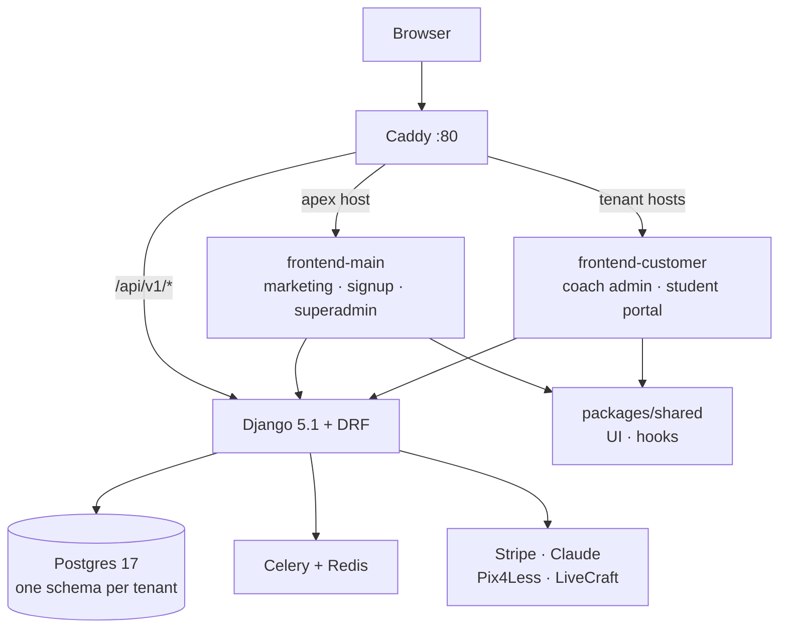

# contentor — Wiki

# Contentor

Contentor is a multi-tenant SaaS for content creators. A **coach** signs up, gets a subdomain (`<slug>.contentor.app`) or a custom domain, and sells courses, downloadable files, live sessions, and email campaigns to their **students**. We, the platform operators, are the **superadmin**. Those three words are used precisely throughout the codebase — with one inversion worth knowing on day one: user-facing copy says _creator_, never "coach". `docs/GLOSSARY.md` is the authority.

Two decisions explain most of what looks surprising here.

**Tenants are isolated by PostgreSQL schema, not by a `tenant_id` column.** `django-tenants` swaps `search_path` per request based on the incoming hostname. A query that forgets which schema it is in doesn't return the wrong rows — it returns rows belonging to a different paying customer. Every middleware, router, and header convention below exists to make that hard to get wrong by accident.

**A coach's site is authored by AI.** The `/setup` interview asks what they offer, then composes the pages, writes the copy, picks the photos, designs a logo, and screenshots the result for review before go-live. That is why so many modules have an AI half.

## The shape of it



Monorepo layout: `backend/` (Django, `config/` + `apps/`, settings split base/dev/prod), `frontend-main/` and `frontend-customer/` (two independent Next.js 14 App Router apps), `packages/shared/` (UI primitives both apps re-export), `e2e/` (Playwright), plus `infra/`, `monitoring/` and the compose files.

## Start here

[Core Platform & Multi-Tenancy](core-platform-multi-tenancy.md) is the first page to read. It owns the middleware chain every request passes through — region and locale, then PostgreSQL schema, then auth — and the shared primitives (storage, email, throttling, access control) that every feature app calls. Django apps are split into `SHARED_APPS` (public schema: tenants, plans, platform subscriptions) and `TENANT_APPS` (per-tenant: courses, orders, community), and `apps.core.routers.TenantRouter` keeps the split honest. `apps.mailbox` is deliberately dual-listed: its public rows are our platform inbox, its tenant rows are a coach's.

[Authentication & Accounts](authentication-accounts.md) is the other foundation. There are no server-side sessions — identity is a signed HS256 JWT, and `TenantJWTAuthentication` is DRF's _default_ auth class. That bites newcomers immediately: a genuinely public endpoint (magic link, OAuth callback, signup) must set `@authentication_classes([])`, because authentication runs before permissions and a bad token 401s before `AllowAny` is ever consulted. The `User` table lives in every schema — coaches and superadmins in public, students and staff in each tenant.

Then pick your half of the product. [Student Portal App (frontend-customer)](student-portal-app-frontend-customer.md) serves every tenant host and holds three audiences in one codebase: anonymous visitor, logged-in student, and coach administering their own site. [Marketing Site App (frontend-main)](marketing-site-app-frontend-main.md) serves the apex host — marketing pages, signup, onboarding, and the superadmin console. Both consume [Shared UI Library](shared-ui-library.md) through re-export shims, which is also where the loading, toast and navigation conventions enforced by `make lint` are defined; following them up front saves a failed-lint round trip.

## What a coach gets

Site structure _and_ content are one Django resource: `GET/PATCH /api/v1/admin/config/`, backed by `TenantConfig` and documented in [Tenant Config & Site Builder](tenant-config-site-builder.md). Brand, navbar, the block tree of every public page, the chatbots' knowledge, the publish gate — all of it.

[Onboarding Wizard & Site AI](onboarding-wizard-site-ai.md) is what fills that resource in. The `/setup` interview runs a Claude conversation, composes pages from the style system, writes the copy, and hands off to a final visual check that screenshots every page (desktop in both colour schemes, plus a phone) and reviews the shots before go-live. The brand mark comes from [Logo Studio & Brand Identity](logo-studio-brand-identity.md), which rests on one invariant worth internalising: **a logo is a versioned `LogoRecipe` JSON, never an image.** Preview, dark variant, brand-kit zip and exported PNGs are all pure functions of that recipe, rasterized once in the browser at export time.

What gets sold divides cleanly. [Courses, Downloads & Media Library](courses-downloads-media-library.md) covers everything consumed on demand — courses, files, the media library, and the access gating in front of them. [Live Events & Calendar](live-events-calendar.md) covers everything that happens at a _time_: live sessions, streams, Zoom calls, in-person events. The video itself is not in this repo — `apps.live.livecraft` creates rooms in LiveCraft, a sibling product, and the portal iframes the join link. (The newest app, `apps.reels`, cuts short vertical clips out of a coach's own videos through the `video` sidecar; it has no generated page yet.)

Money runs through [Billing & Payments](billing-payments.md), which carries two independent flows over shared models and a single webhook endpoint: the coach's platform subscription (Checkout on our Stripe account, state in the public schema) and the marketplace (direct charges on their connected account, with a platform application fee).

Students are reached through [Email Campaigns](email-campaigns.md) — block-JSON emails rendered by Contentor's own engine in `apps.email_campaigns`, edited in `packages/shared/src/email/editor`, personalised per recipient and fanned out by Celery, with the platform side mirroring the same engine for superadmin → coach mail. Alongside it: [Mailbox & Notifications](mailbox-notifications.md) for threaded real email, announcements and Web Push, [Blog & AI Content](blog-ai-content.md) for AI-drafted posts, and [Community](community.md) for the in-tenant social feed the coach moderates. When a coach outgrows the subdomain, [Custom Domains](custom-domains.md) owns the whole lifecycle: availability search, priced checkout, registration, DNS zone and records, email authentication, SSL, and yearly renewal.

## What we get

[Superadmin Platform Console](superadmin-platform-console.md) is the cross-tenant control surface — every workspace, plan, subscription, AI dollar and help-bot conversation, all in the public schema, which is why it is served from the apex host rather than the tenant portal. Its screens are generated rather than hand-written: [Admin Kit Framework](admin-kit-framework.md) turns one Python declaration per model into both a CRUD REST surface and the JSON metadata a generic React renderer uses to build tables, filters, forms and bulk actions.

For "what is the platform doing right now", see [Observability & Usage Analytics](observability-usage-analytics.md). There is no Prometheus and no Grafana — `vector` ships every container's logs into the in-app logbook, and that **is** the observability stack.

Everything Claude-shaped funnels through [AI Infrastructure & Assistants](ai-infrastructure-assistants.md): one provider layer, one SSE framing convention, one conversation kernel with cost governance, and the chat surfaces on top. Modules that draft a blog post, compose a site or critique a logo call into it rather than talking to a model directly.

## Flows worth tracing once

**A request finds its tenant.** Caddy matches the host — apex to `frontend-main`, everything else to `frontend-customer` — while `/api/*`, `/static/*` and apex `/django-admin/*` bypass Next.js entirely and hit Django. Django then resolves region, schema, and JWT in that order. The trap: a Next.js **server-side** `fetch()` to Django must send an `X-Tenant-Domain` header, because Node's undici silently drops a custom `Host` and you land in the public schema reading the wrong data, quietly and successfully.

**A coach becomes a live site.** Signup on the marketing site → card verification and Checkout → tenant provisioning, which creates the user in _both_ the public schema (`role=coach`) and the new tenant schema (`role=owner`, staff) → the `/setup` interview → AI composition writing into `TenantConfig` → the screenshot review → publish.

**A student buys something.** A magic link auto-registers the student in the tenant schema → they browse courses or the calendar → embedded Stripe Checkout runs on the coach's connected account → the webhook writes the order → access gating opens the content, and `notifications.transactional` sends the receipt through the same renderer the campaigns use.

## Running it locally

```bash
make health-check   # it is probably already up
make dev-d          # whole stack, detached; returns when Django is healthy
make migrate seed   # schemas, then the demo tenant + plans + superusers
make help           # everything else
```

Dev config is a root `.env` (start from `.env.example`). There is no `.env.prod` — production secrets live in Cloudflare KV and are fetched at deploy time. Dev bundles MinIO for object storage and can fake the paid dependencies (`CURATED_IMAGE_API_FAKE`, `BILLING_BYPASS_ENABLED`, a no-op LiveCraft with inert join links).

Verify at the cheapest level that covers your change: `make test-changed` picks backend tests from the diff, `make test-app APP=billing` scopes to one app, `make e2e-spec SPEC=04-live-class` runs a single Playwright spec. Full `make test` and full `make e2e` are for shared runtime code only — and because the e2e suite shares the demo tenant and the Docker VM with other sessions, check that no run is already going before you start one. [Developer Tooling & Flowmap](developer-tooling-flowmap.md) explains how the selective runners decide what to run; [Other](other.md) covers the compose files, Caddyfile, agent instruction surface and the rest of the scaffolding that no code imports but everything depends on.

## Where to look next

These pages are generated from the code graph and describe _design intent_; for exact current callers and blast radius, query the GitNexus tools rather than trusting a page's call list. Beside the wiki, `docs/REFERENCE.md` is the cross-cutting reference (domain model, auth and tenancy flows, billing, integrations, deploy), `docs/GLOSSARY.md` fixes the vocabulary, and `docs/PRODUCT.md` is the living product plan for "what's next" rather than "how does this work".
