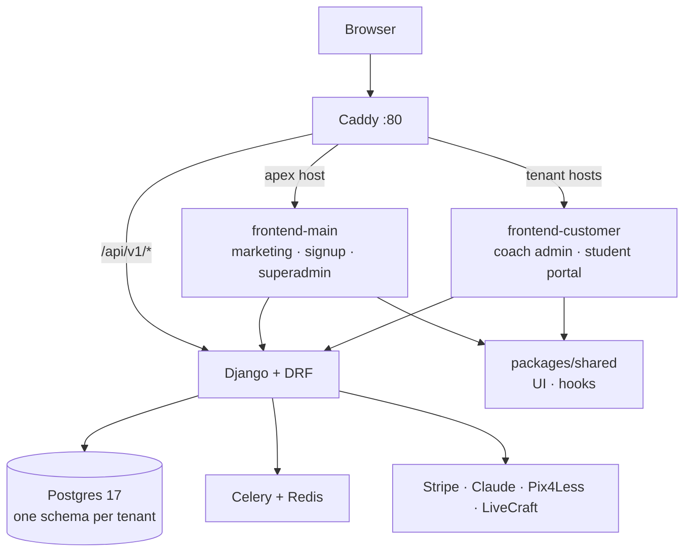

# contentor — Wiki

# Contentor

Contentor is a multi-tenant SaaS for content creators. A **coach** signs up, gets their own subdomain (`<slug>.contentor.app`) or custom domain, and sells courses, downloadable files, live classes, and email campaigns to their **students**. We — the platform operators — are the **superadmin**.

The defining technical fact: tenants are isolated by **PostgreSQL schema**, not by a `tenant_id` column. `django-tenants` swaps `search_path` per request based on the incoming hostname. A query that forgets which schema it is in doesn't return the wrong rows — it returns rows from the wrong _company_. Almost every surprising thing in this codebase traces back to that one decision.

The second defining fact: a coach's site is **authored by AI**. The onboarding interview asks what she teaches, then composes pages, writes copy, picks photos, designs a logo, and screenshots the result for review before go-live. That's why so many modules have an AI half.

## The shape of it



Monorepo layout: `backend/` (Django 5.1, `config/` + `apps/`), `frontend-main/` and `frontend-customer/` (two independent Next.js 14 App Router apps), `packages/shared/` (UI primitives both apps re-export), `e2e/` (Playwright), `infra/` and `docker-compose.yml` (the stack).

## Start here

[Core Platform & Multi-Tenancy](core-platform-multi-tenancy.md) is the page to read first. It owns the middleware chain every request passes through — region/locale resolution, then schema selection, then auth — plus the shared primitives (storage, email, throttling, access control) that all feature apps call. Django apps are split into `SHARED_APPS` (public schema: tenants, plans, platform subscriptions) and `TENANT_APPS` (per-tenant: courses, orders, community), and `apps.core.routers.TenantRouter` enforces the split.

[Authentication & Accounts](authentication-accounts.md) is the other foundation. There are no server-side sessions — identity is a signed JWT, and `TenantJWTAuthentication` is DRF's _default_ auth class. The consequence bites new developers immediately: a genuinely public endpoint (magic link, OAuth callback, signup) must set `@authentication_classes([])`; `AllowAny` alone is not enough, because authentication runs before permissions and a bad token 401s first.

Then pick the half of the product you're working in: [Student Portal App (frontend-customer)](student-portal-app-frontend-customer.md) serves every tenant host and holds three audiences in one codebase (visitor, student, coach-admin), while [Marketing Site App (frontend-main)](marketing-site-app-frontend-main.md) serves the apex host — marketing pages, signup, and the superadmin console. Both consume [Shared UI Library](shared-ui-library.md) through re-export shims, which is also where the loading/toast/navigation conventions enforced by `make lint` live.

## What a coach gets

Site structure and content are one Django resource: `GET/PATCH /api/v1/admin/config/` backed by `TenantConfig`, documented in [Tenant Config & Site Builder](tenant-config-site-builder.md). Brand, navbar, the block tree of every public page, and the chatbots' knowledge all live there. [Onboarding Wizard & Site AI](onboarding-wizard-site-ai.md) is what fills it in: the `/setup` interview runs a Claude conversation, composes pages from the style system, and hands off to a final visual check that screenshots every page and reviews the shots before go-live.

Her brand mark comes from [Logo Studio & Brand Identity](logo-studio-brand-identity.md), which rests on one invariant worth internalising: **a logo is a versioned `LogoRecipe` JSON, never an image** — preview, dark variant, brand-kit zip, and exported PNGs are all pure functions of that recipe, rasterized once in the browser.

What she sells splits across [Courses, Downloads & Media Library](courses-downloads-media-library.md) (anything consumed on demand) and [Live Events & Calendar](live-events-calendar.md) (anything that happens at a _time_ — live classes, streams, Zoom, in-person). Video itself is not here: `apps.live.livecraft` creates rooms in LiveCraft, a sibling product, and the portal iframes the join link.

Money runs through [Billing & Payments](billing-payments.md), which carries two independent flows over shared models and a single webhook endpoint: the coach's platform subscription (Checkout on our Stripe account, state in the public schema) and the marketplace (direct charges on the coach's connected account, platform takes an application fee).

She reaches her students through [Email Campaigns](email-campaigns.md) — block-JSON emails rendered by Contentor's own engine in `apps.email_campaigns`, with the editor in `packages/shared/src/email/editor` — plus [Mailbox & Notifications](mailbox-notifications.md) for threaded real email, announcements and Web Push, [Blog & AI Content](blog-ai-content.md) for AI-drafted posts, and [Community](community.md) for the in-tenant social feed she moderates. If she outgrows the subdomain, [Custom Domains](custom-domains.md) handles the whole lifecycle from availability search through DNS, email auth, SSL, and yearly renewal.

## What we get

[Superadmin Platform Console](superadmin-platform-console.md) is the cross-tenant control surface — every workspace, plan, subscription, AI dollar and help-bot conversation. Its screens are generated, not hand-written: [Admin Kit Framework](admin-kit-framework.md) turns one Python declaration per model into both a CRUD REST surface and the JSON metadata a generic React renderer uses to build tables, filters, forms and bulk actions.

For "what is the platform doing right now", see [Observability & Usage Analytics](observability-usage-analytics.md). There is no Prometheus or Grafana — `vector` ships every container's logs into the in-app logbook, and that **is** the observability stack.

Everything Claude-shaped funnels through [AI Infrastructure & Assistants](ai-infrastructure-assistants.md): one provider layer, one SSE framing convention, one conversation kernel with cost governance, and the chat surfaces built on top. Feature modules that draft blog posts, compose sites, or critique logos all call into it rather than talking to a model directly.

## Flows worth tracing once

**A request finds its tenant.** Caddy matches the host → apex goes to `frontend-main`, anything else to `frontend-customer`, while `/api/*`, `/static/*` and apex `/django-admin/*` bypass Next.js entirely and hit Django. Django's middleware resolves region, then schema, then the JWT. The trap: a Next.js **server-side** `fetch()` to Django must send an `X-Tenant-Domain` header — Node's undici silently drops a custom `Host`, so without it you land in the public schema and quietly read the wrong data.

**A coach becomes a live site.** Signup on the marketing site → card verification and Checkout → tenant provisioning (the user is created in _both_ the public schema as `coach` and the tenant schema as `owner`) → the `/setup` interview → AI composition writing into `TenantConfig` → the screenshot review → publish.

**A student buys something.** Magic link auto-registers her in the tenant schema → she browses courses or the calendar → embedded Stripe Checkout on the coach's connected account → the webhook writes the order → access gating in `courses`/`billing` opens the content, and `notifications.transactional` sends the receipt through the same email renderer the campaigns use.

## Running it locally

```bash
make dev-d          # whole stack, detached, returns when Django is healthy
make migrate seed   # schema + demo tenant
make health-check   # is it already up?
```

Config comes from a root `.env` (dev) — there is no `.env.prod`; production secrets live in Cloudflare KV. Dev bundles MinIO for object storage and can run fakes for the paid dependencies (`CURATED_IMAGE_API_FAKE`, `BILLING_BYPASS_ENABLED`, a no-op LiveCraft).

Verify at the cheapest level that covers your change: `make test-changed` picks backend tests from the diff, `make test-app APP=billing` scopes to one app, `make e2e-spec SPEC=04-live-class` runs a single Playwright spec. Full `make test` and full `make e2e` are for shared runtime code — and the e2e suite is shared infrastructure, so check `pgrep -fl 'playwright test'` before starting one. [Developer Tooling & Flowmap](developer-tooling-flowmap.md) explains how the selective runners decide what to run; [Other](other.md) covers the compose files, agent instruction surface, and the rest of the scaffolding.

## Where to look next

These wiki pages are generated from the code graph and describe _design intent_ — for exact current callers and blast radius, query the GitNexus MCP tools instead. Alongside them, `docs/REFERENCE.md` is the cross-cutting reference (domain model, auth and tenancy flows, billing, deploy), `docs/GLOSSARY.md` fixes the terminology, and `docs/PRODUCT.md` is the living product plan if you're asking "what's next" rather than "how does this work".
