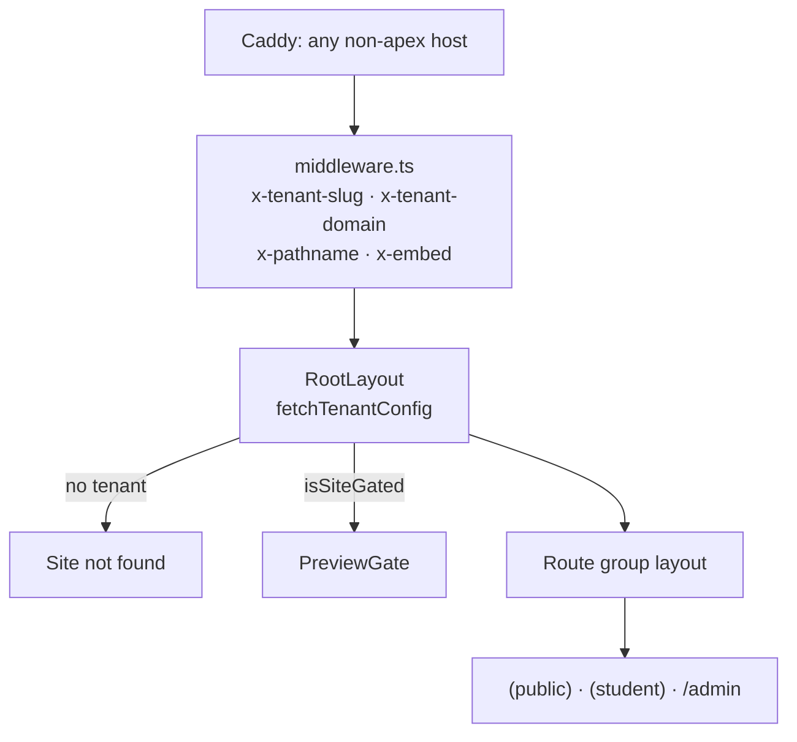

# Student Portal App (frontend-customer)

# Student Portal App (`frontend-customer`)

The tenant-facing Next.js 14 app. Every host that is **not** the apex domain — `<slug>.contentor.app`, a coach's custom domain, `<slug>.localhost` in dev — is routed to this app by Caddy. It serves three audiences from one codebase:

| Audience | Routes                                                                            | Who                                        |
| -------- | --------------------------------------------------------------------------------- | ------------------------------------------ |
| Visitor  | `(public)` — `/`, `/about`, `/courses`, `/plans`, `/blog`, …                      | anonymous, or a logged-in student browsing |
| Student  | `(student)` — `/dashboard`, `/learn/[slug]`, `/orders`, `/community`, `/checkout` | end users inside the tenant                |
| Coach    | `/admin/*`, `/setup`                                                              | the tenant owner (role `owner` / `coach`)  |

The marketing site, signup and superadmin live in the _other_ app, `frontend-main`. Shared UI and hooks come from `packages/shared` via the `@shared/*` alias; `@/*` is this app's own `src/`.

---

## Request lifecycle

Nothing in this app knows which tenant it is serving until `src/middleware.ts` says so. Every server component reads the answer back off request headers.



### 1. `middleware.ts`

Derives the tenant from `Host` and stamps four request headers:

- `x-tenant-slug` — the first label for `*.{BASE_DOMAIN}` hosts, the whole host for custom domains. In development an `x-dev-tenant` request header overrides it.
- `x-tenant-domain` — the full host **with port**, the value every Django call must forward.
- `x-pathname` — so the root layout can branch on the route (the publish gate's bypass list, `isAdminPath`). Server components cannot read the pathname otherwise.
- `x-embed` — set only when `?embed=1`, the `/setup` preview iframe. Explicitly deleted otherwise so a client cannot forge it.

The matcher excludes **all** of `_next`. That is load-bearing: a narrower list let middleware run on `_next/webpack-hmr` and Caddy logged a steady stream of `502 malformed HTTP response "Unauthorized"`. App Router RSC requests hit real route paths with `?_rsc=`, so they still get the headers.

### 2. `src/app/layout.tsx` — the root layout

Runs on every request (`dynamic = "force-dynamic"`) and does five jobs:

1. **Resolve the tenant.** `getTenantSlug()` → `fetchTenantConfig(slug)`. A `null` config for a real-looking slug renders an inline "Site not found" page — `notFound()` is illegal in a root layout (`NotAllowedRootNotFoundError`), and `fetchTenantConfig` already retried, so `null` means the tenant genuinely does not exist.
2. **Gate unpublished sites.** `isSiteGated()` returns true when the config is unpublished or paused, unless the path is in `GATE_BYPASS_PREFIXES` (`/login`, `/callback`, `/impersonate`), the `contentor_preview` cookie matches the slug (unpublished only — never a paused site), or the viewer is the owner. Gated requests render `<PreviewGate>` instead of `children`.
3. **Paint the look.** `<TenantThemeStyle>` emits the tenant's style/palette as one `<style id="tenant-theme">` sheet, plus the style's Google Fonts `<link>`. `ThemeProvider` (next-themes, `storageKey = "theme"`) carries one light/dark choice for both the site and the coach admin.
4. **Provide context.** `TenantProvider` puts the fetched `TenantConfig` into React context; client components read it with `useTenant()`. There is no client-side config fetch.
5. **Mount the always-on chrome:** `NavigationProvider` + `NavigationProgress`, `AppToaster`, `TrackPageView`, `RedirectToast`, `InstallPrompt`, `SwUpdateToast`, `PushOptIn`, `UsageReporter`.

`generateMetadata` and `generateViewport` also live here: tenant title template (`%s · <Brand>`), a description that falls back to the home hero's subheading rather than shipping an empty one, and `/pwa-icon` favicons versioned by `icon_id`/`logo_id`.

### 3. Route-group layouts

- **`(public)/layout.tsx`** — public header/footer, and the owner's editing chrome. If the viewer is a coach it fetches the config and wraps the page in `<EditSidebar>`; if guided setup is still running it `redirect("/setup")`. Both are skipped when `x-embed` is set, so the `/setup` preview iframe shows the site exactly as a visitor sees it. Nav links are pruned by `/api/v1/site/menu/` and the plans list, both **fail open** — a fetch hiccup must not silently hide a coach's Pricing link.
- **`(student)/layout.tsx`** — `requireAuth()`, then the same `PublicHeader` plus subscription and community state, `ImpersonationBanner`, and the student-facing assistant bubble.
- **`admin/layout.tsx`** — `requireAuth()` + `requireRole(user, ["owner","coach"])`, `setupFlowActive` redirect, then `<AdminShell>`. A paused tenant gets `<PausedPlanPicker>` in place of every admin page.

Both `setupFlowActive(slug)` and `sitePaused(slug)` come from `app/setup/gate.ts`. They re-read the config with the cache busted when the flag reads true, so a coach who just finished setup is not held on `/setup` for the length of the config TTL.

---

## Talking to Django

Two clients, chosen by where the code runs:

```
Server component / route handler  →  serverFetch()  →  http://django:8000  (direct)
Client component                  →  clientFetch()  →  /api/v1/...         (Next rewrite → Django)
```

**`lib/api-server.ts` — `serverFetch<T>(path, options)`**
Attaches the JWT from the session cookie and, critically, `X-Tenant-Domain` from `x-tenant-domain`. Node's undici silently drops a custom `Host` header, so without this header Django resolves `Host: django` to the **public schema** and the request reads the wrong tenant. Guards both an empty error body and a 204/empty success body (Cloudflare can strip `Content-Length`); failures throw `ApiError(status, data)`.

**`lib/api-client.ts` — `clientFetch<T>(path, options)`**
Browser-side, same-origin, so the tenant comes from the real `Host`. Adds the tracking session header, skips `Content-Type` for `FormData`, and throws `ApiError` carrying `retryAfter` from the server's `Retry-After`. Companions: `isTransientApiError` (429, 5xx, network `TypeError`), `retryTransient` (retries those, honours but caps the hint — the tenant rate limiter suggests 60s and a page gate must fail to its error state instead of hanging), and `batchedAsync` for bulk operations.

**`lib/tenant.ts` — `fetchTenantConfig(slug)`**
Hits `/api/v1/admin/config/` keyed by the live request host, so custom domains resolve to the right `Domain` row. It distinguishes _definitively absent_ (Django 404 → `null`, caller may 404 the page) from _transient_ (network error/5xx → one retry) — misreporting a blip as "no tenant" shows "Site not found" on a valid site. `configCache` is a per-process map with a 5s TTL in prod and **disabled in development**, so e2e specs that PATCH config and immediately assert the public page are not racing a warm cache.

> `getTenantDomain()` returns empty inside `generateMetadata` and `manifest.ts` (headers are unavailable there). Those paths build the domain from `${slug}.${BASE_DOMAIN}` instead — follow the same pattern in any new metadata route.

### Route handlers (`src/app/api/`)

Thin proxies that exist only because a cookie or a `Host` workaround is needed:

- `auth/verify` — magic-link verification. Builds the Django URL from the hostname (undici ignores custom `Host`) and forwards Django's `set-cookie` verbatim.
- `auth/google`, `auth/impersonate/{verify,stop}`, `auth/logout` (re-exported from `@shared/auth/logout-route`).
- `preview/unlock` — posts the password to `/api/v1/preview/unlock/` and, on success, sets the httpOnly `contentor_preview` cookie to the tenant slug. That cookie is what `isSiteGated` checks.
- `admin/config` — the owner's config writes.

---

## Builder pages

`/`, `/about`, `/contact`, `/faq` and the other composed pages are all the same four lines: read the config, pull `config.pages.<key>.blocks`, prefetch what those blocks need, render.

```tsx
const config = await fetchTenantConfig(await getTenantSlug());
const blocks = config?.pages?.about?.blocks ?? [];
const dynamicData = await fetchDynamicData(blocks);
return (
  <PageView
    pageKey="about"
    blocks={blocks}
    dynamicData={dynamicData}
    pageTitle={PAGE_LABELS.about}
  />
);
```

`fetchDynamicData(blocks)` (`lib/blocks/fetch-dynamic-data.ts`) asks the block registry which datasets the enabled blocks reference (`dynamicKeysForBlocks`) and fetches only those — `courses`, `plans`, `events`, `storeProducts`. A page with no dynamic blocks makes zero extra requests, and each slice is independent: one failing endpoint leaves its key `undefined` and that block renders its own empty state rather than taking down the page.

`PageView` is the fork between the two renderers: coaches get `EditModeCanvas` (drag-and-drop, blocks read from the editor store), everyone else gets the static server-rendered `PageRenderer`, so the public HTML and its SEO are unaffected by the editor existing.

To add a page kind: register the block in `lib/blocks/registry`, add its dynamic key to `fetchDynamicData`, add the route with its `loading.tsx`.

---

## Auth and sessions

`lib/auth.ts` holds the whole server-side story:

- `getAuthUser()` — reads the JWT cookie, calls `/api/v1/auth/users/me/` with the tenant domain, and memoises the **promise** for 60s keyed by `domain:token`, so a layout and its page do not each pay for the round trip. A rejection evicts the entry.
- `requireAuth()` — redirects to `/login?toast=…` when absent; used by `(student)` and `/admin` layouts.
- `requireRole(user, roles)` — redirects to `/` on mismatch.

Roles seen throughout: `owner`/`coach` (the tenant owner — the two are treated interchangeably in nearly every check) and `student`. Sign-out everywhere is `POST /api/auth/logout` followed by `navigate("/login?toast=…")` and `router.refresh()`.

---

## Theming

Three pieces cooperate so that the site wears the coach's look while the admin wears the app's own:

| Piece                                                    | Role                                                                                                                                                        |
| -------------------------------------------------------- | ----------------------------------------------------------------------------------------------------------------------------------------------------------- |
| `TenantThemeStyle`                                       | Renders `styleRootCss(siteLook(style), custom_css, palette)` as `<style id="tenant-theme">`; `off` renders it `media="not all"`                             |
| `ThemeProvider` (`components/shared/theme-provider.tsx`) | next-themes wrapper that flips that sheet's `media` by id on in-app navigation between site and admin — the root layout only gets that right on a full load |
| `TenantThemeEnforcer`                                    | Normalises a legacy stored `"dim"` value to `dark`                                                                                                          |

`lib/site-styles.ts` is the single source for look resolution: `siteLook`, `paletteOf`, `modePalette`, `styleDefaultTheme`, `styleVars`, `styleFontsHref`, `lookPrimaryHex` (used for `theme_color` in the manifest, viewport and PWA icon), and `isAdminPath`. A site with `dark_mode_enabled === false` is force-held at its style's default theme for visitors — but `ThemeProvider` drops `forcedTheme` under `/admin`, so the coach can always choose.

> Known rough edge: tenant colours only re-paint on a full page load. Client-side navigation after a look change still shows the old look.

---

## PWA

Every tenant gets its own installable app, branded from its config.

- **`manifest.ts`** — name, description and `theme_color` from the tenant config; icons point at `/pwa-icon?size=…&v=<icon_id|logo_id>`.
- **`pwa-icon/route.tsx`** — renders the icon with `next/og`. `markSrc()` fetches the mark from Django _inside the Docker network_ (the browser-facing storage host may not resolve there) and inlines it as a data URL, because `next/og` cannot decode WebP or AVIF. Falls back: square app icon → wide logo → brand initial on the primary-colour tile. Versioned URLs are `immutable`; unversioned must revalidate.
- **`sw.ts`** (Serwist, compiled to `public/sw.js`) — `NEVER_CACHE` matches first so `defaultCache` never sees `/admin`, `/checkout`, `/api/v1/auth`, `/api/v1/billing` or any `stripe.com` traffic. Also handles `push` → `showNotification` and `notificationclick` → focus-or-open the target URL. Offline fallback is `/offline.html`.
- **`InstallPrompt`** — captures `beforeinstallprompt`, or shows the iOS / in-app-browser hint. Hidden for coaches (`hide={isStaff}`), under `/admin` and `/setup`, in standalone mode, and after dismissal (`localStorage: pwa-install-dismissed`). It publishes `--install-banner-clearance` so the copilot launcher can lift above it.
- **`/install`** → `InstallGuide` — platform-detected step-by-step with the theme-aware SVGs in `install-illustrations.tsx` (colours reference OKLCH tokens directly as `var(--token)`, never wrapped in `hsl()`).
- **`SwUpdateToast`** — a new worker reaching `installed` with an existing controller offers a Refresh toast.

Helpers live in `lib/usage.ts` (`detectPlatform`, `isInAppBrowser`, `reportUsageOncePerSession`) and `lib/push.ts` (`pushSupported`, `isStandalone`, `subscribeToPush`, `syncPushOncePerSession`).

---

## Coach admin (same app, different shell)

`/admin/*` ships inside this app rather than a separate one, because the coach edits her live site in place.

`lib/admin-nav.ts` → `buildAdminNav(t)` is the single source for the information architecture — seven sections (`home`, `teach`, `students`, `reachOut`, `money`, `site`, `settings`) feeding the sidebar, the section tabs, the phone drawer and the ⌘K command palette. `sectionHref(section)` resolves a section to its first non-external page; `activeSection(sections, state)` resolves the current path back to a section (prefix-matched, so `/admin/courses/new` is still _Teach_). Both are pure and covered by `lib/__tests__/admin-nav.test.ts`.

`lib/admin-nav-gate.ts` → `gateAdminNav(sections, state)` hides pages whose module the coach did not enable (`MODULE_FOR_HREF` maps `/admin/live` → `live`, `/admin/downloads` → `downloads`), counts them as `hiddenCount` for the tab strip's "+ N more", and always keeps the page the coach is currently on visible. `AdminShell` fails open while `config === null` so an established coach never watches her tabs pop in.

Each `NavItem.key` is the message key under `nav.items` — the page's `<h1>` reads the same key, so the sidebar, the tab and the heading cannot drift apart.

---

## Conventions to follow when contributing

These are enforced by `scripts/check-loading-patterns.mjs` in `make lint`; writing them correctly up front saves a round trip.

- **Navigation:** `<NavLink>` (never raw `next/link`) and `useNavigate()` (never `router.push`) for internal moves — they drive the top progress bar. `useTransition`'s `isPending` is not a usable navigation signal in the App Router.
- **Loading:** client pages wrap their initial load in `<PageState loading error skeleton onRetry>` with presets from `@/components/ui/skeletons`; every route segment needs a `loading.tsx` at or above it. Refinement loads (search/filter/sort) use `<StaleContainer pending>` — rows dim, never blank.
- **Async actions:** `useAsyncAction` from `@shared/hooks/use-async-action` (loading state, double-submit guard, error toast); `<Button loading loadingText>` and `<Spinner>` — never a raw `<Loader2>` or `animate-spin`.
- **Outcomes** are sonner toasts; field validation stays inline. Motion is CSS-only and `motion-safe:`-gated.
- **Serializers:** after any Django serializer change, run `npm run gen:api` and review `src/types/api-generated.ts` — a surprising diff means the contract moved.

### i18n

`src/i18n/config.ts` + `request.ts`. English is the only locale; `resolveLocale` falls back for a stale `user-locale` cookie. Messages are split into four namespaces loaded per request: `admin`, `student`, `common`, `pwa` (`messages/en/*.json`).

### Gotchas worth knowing before you debug

- A server-side `fetch` to Django without `X-Tenant-Domain` reads the **public schema**, not the tenant — it fails quietly with wrong data, not an error.
- `getTenantDomain()` is empty in `generateMetadata` and `manifest.ts`; build the domain from the slug there.
- `/api/*`, `/static/*` are served by Django directly through Caddy and never proxied through Next — the `/api/v1/:path*` rewrite in `next.config` is the browser-side path only.
- Blank pages or hangs in e2e are usually a transient `nextjs-customer` 502, not a code bug.
- `dynamic = "force-dynamic"` is on every tenant-dependent route. Removing it caches one tenant's page for another.
