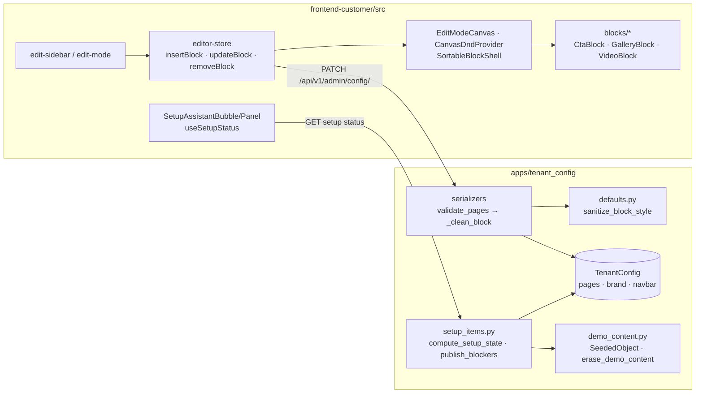

# Tenant Config & Site Builder

# Tenant Config & Site Builder

How a coach's tenant site is configured, composed, and published. One Django resource — `GET/PATCH /api/v1/admin/config/` → `TenantConfig` — backs everything: brand, navbar, the block tree of the public pages, the two chatbots' knowledge, and the demo-content/publish gate.

Sub-modules:

- [Tenant Config & Site Builder — apps](tenant-config-site-builder-apps.md) — `backend/apps/tenant_config/`: the `TenantConfig` model and its page/block schema, `SeededObject` demo tracking, `setup_items.py` checklist + publish blockers, `AssistantConfig`.
- [Tenant Config & Site Builder — src](tenant-config-site-builder-src.md) — `frontend-customer/src`: the in-place editor sidebar, the canvas editor store, the block components, and the Setup Assistant UI.

## How the halves meet

There is no `/admin/design` route and no second source of truth. The editor mounts **over the live public site** when the viewer is a coach/owner; the blocks it drags around are the same JSON the public renderer reads.

**Editing a page.** `BlocksTab` and the canvas (`SortableBlockShell`, `CanvasDndProvider`, `DropZone`) all mutate the single `editor-store`; `lib/blocks/registry.tsx` seeds new blocks from `examples.ts` and `field-renderer.tsx` renders their fields. The store PATCHes the whole `pages` tree, which `validate_pages` → `_clean_block` → `sanitize_block_style` scrubs server-side — so the block schema in `defaults.py` is the contract the frontend registry must match. Change one side and the other goes silently lossy.

**Getting to live.** Seeded demo rows are tracked as `SeededObject`; `compute_setup_state` turns them plus `_has_own` / `_has_paid_content` into the checklist, and `publish_blockers` gates go-live. `erase_demo_content` sweeps them, keeping anything a coach's blocks still reference (`_photo_referenced`).

**Setup status leaks widely.** `useSetupStatus` / `refreshSetupStatus` (and `useTenantCurrency` beside them in `src/lib/setup-assistant.ts`) are pulled in by admin pages far outside the builder — plans, bundles, courses — so they sit on the hot path of most coach-admin loads. Treat changes there as cross-cutting.
